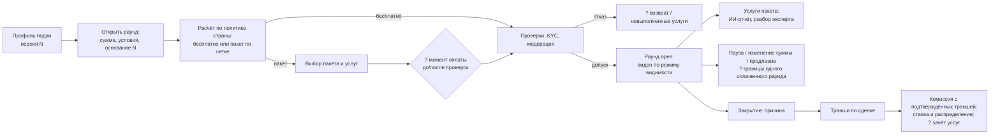
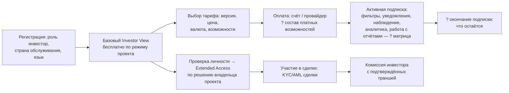

# Инвестиционная заявка — технический план

Этап 0, коммит 0.2 плана `docs/product/план-этапов-заявки.md`. Дата: 2026-09-14.
Код: `main` @ `1ac0733`. Основание: `заявка-01-что-есть-в-коде.md` (далее «0.1»)
и постановка v3 (`docs/product/постановка-инвестиционная-заявка-v3.md`).

**Статус: на утверждение владельца.** Спорные места собраны в §9; без решения
по ним этап 2 не начинается.

---

## 0. Коротко

Заявка становится отдельной сущностью `lab.investment_applications` с
типизированными core-полями и ответами по стабильным ключам в JSONB. Снимок при
подаче остаётся в `lab.project_versions`: таблица расширяется ссылкой на
заявку, версией схемы вопросов, версией конфигурации готовности и процентом,
а `season_id` перестаёт быть обязательным. Проект хранит указатель на текущую
заявку, и при подаче её стадия и сумма **проецируются** в существующие
колонки проекта — благодаря этому каталог, тариф, триггеры биллинга, скоринг
и интеграционный API работают без изменений.

Структура формы (разделы, вопросы, типы, применимость по стадии и типу
бизнеса, видимость) — типизированный код в `packages/contracts` с номером
версии. Продуктовые тексты и переводы — в БД по образцу `content.landing_blocks`,
с запасным текстом в коде. Веса готовности — версионируемая таблица с одной
активной версией. Ограничения основателя (сколько заявок, какая сумма) —
версионируемая политика, не тариф.

Всё — expand-only: новые таблицы и колонки, ни одного `DROP`. Старый путь
`create → materials → submit → analysis → listing` сохраняется как обёртка.

---

## 0а. Изменение продуктовых правил (владелец, 2026-09-14, вечер)

Зафиксировано после первой редакции плана. Эти правила действуют на **первую
очередь** продукта — этапы 1–7 этого плана — и имеют приоритет над всем, что
ниже написано о тарифах.

0. **Прежние продуктовые правила не считаются утверждёнными требованиями.**
   Функционал раньше системно не проектировался: многие правила предлагались
   для программы и записывались без проверки и согласования (`README.md`
   §«Модель монетизации», `Architect_Launch.md` §5, комментарии в коде и
   миграциях). Существующий код показывает, **как система работает сейчас**,
   и не доказывает, что такая логика подходит. Правило работы для всех
   этапов: сверять поведение кода с текущей постановкой и §0а, отмечать
   расхождения в плане и в руководстве по продукту (§13), предлагать
   совместимый переход; **не сохранять старое правило только потому, что оно
   реализовано, и не удалять работающий код без понимания последствий**
   (`dont-treat-implementation-as-spec`). Примеры расхождений, уже найденных
   так: тариф по сумме как барьер листинга (§2.9), сезон как условие подачи
   (§2.14), точное совпадение тарифа подписки (§2.9), `suspended_billing`,
   который никто не проставляет.
1. **Инвестор.** Подписка инвестора даёт доступ к просмотру заявок либо не
   даёт. Лимита на число просматриваемых заявок нет и не планируется. В коде
   это уже так: `lab.has_active_investor_membership` (`M009:228-243`) —
   единственный гейт, счётчиков нет. Ничего не меняется.
2. **Основатель создаёт и подаёт заявки бесплатно.** Подача не привязана к
   покупке тарифа; заявка не скрывается от инвесторов из-за суммы запроса.
3. **Тарифную инфраструктуру не удалять**: планы, подписки, резолвер по
   сумме, триггер и счета остаются и продолжают считаться — но перестают
   быть барьером (§2.9).
4. **Ограничения основателя — настраиваемая политика**: сколько заявок он
   может иметь и какую сумму запросить в каждой; в том числе против
   дробления одного запроса на много заявок. Значения меняются без релиза.
   Это **настройка**, а не решение, которого ждём: сид версии 1 берёт
   стартовые значения из примера («до трёх заявок, каждая до 5 млн»), а
   заказчик меняет их в админке, когда сочтёт нужным (§2.8). Реализацию
   это не блокирует.
5. **Правило «максимум суммы по открытым заявкам определяет обязательный
   платный тариф» в первой очереди не применяется.** Расчёт максимума
   сохраняется только как совместимость с нынешним биллингом, без платёжного
   барьера (§2.9).
6. **Модель заработка — сделки** через трёхстороннее соглашение на платформе
   с долей около 10%. Это ориентир для будущего процесса сделки, не условие
   подачи (§12).

**Что это отменяет из первой редакции плана:**

| Было предложено                                                                                 | Статус                                                                                                  |
| ----------------------------------------------------------------------------------------------- | ------------------------------------------------------------------------------------------------------- |
| Лимит заявок из колонок тарифа `subscription_plans.applications_limit…` (§2.8, первая редакция) | **Отменено.** Колонки не добавляются; лимиты только из `lab.application_policies`.                      |
| Эффективный лимит «тариф при активной подписке, иначе базовая политика»                         | **Отменено.** Один источник — политика.                                                                 |
| Рекомендация Б «максимум по открытым заявкам определяет обязательный тариф» (§2.9)              | **Отменено как барьер.** Максимум считается для совместимости, ничего не блокирует.                     |
| Откат подачи заявки триггером `23514 → planUpgradeRequired` (§2.4)                              | **Отменено.** Подача никогда не блокируется тарифом.                                                    |
| Ослабление `lab.can_list_project` до «подписка покрывает» (§2.9)                                | **Отложено.** Не меняется в этапе 2; понадобится только если барьер включат (приложение к §2.9).        |
| Подсказка в мастере «для листинга с этой заявкой нужен тариф tN»                                | **Отменено** для первой очереди.                                                                        |
| Доступ к AI-review через колонку тарифа `ai_review_included` (§2.12)                            | **Уточнено:** в первой очереди — флаг и ручная выдача; колонка тарифа — когда тарифы вернутся барьером. |
| Спорные места §9 п.1–2 в прежней формулировке                                                   | **Закрыты** решением владельца; новые открытые вопросы — §9.                                            |

Что **не** меняется: разделение проекта и заявки, снимок в `project_versions`,
проекция стадии в проект (проект — производный кеш), схема вопросов в коде,
тексты в БД, веса готовности, сезоны как обёртка старого `submit`, этапы 3–8.

## 0б. Правки владельца при утверждении плана (2026-09-14, поздно)

План утверждён с оговорками: «архитектура описана точнее, чем сама будущая
анкета». Четыре правки записаны до этапа 3, этап 2 они не останавливают:

| Замечание                                                                                         | Где закрыто                                                                                                         |
| ------------------------------------------------------------------------------------------------- | ------------------------------------------------------------------------------------------------------------------- |
| Состав вопросов отложен на 3.1 — до кода мастера нужен обозримый каталог по блокам v3             | §2.5: документ `каталог-вопросов-заявки.md`, коммит 3.0, утверждает владелец; 3.1 переносит его в схему             |
| Сумма и уточнение направления обязательны при создании — противоречит свободному черновику        | §2.2: колонки допускают NULL в черновике, обязательность только при подаче (`canSubmit`, `submit`, условные CHECK)  |
| Этап 4 назван «первым работающим маршрутом», хотя подсказки и словарь — этап 5, карточка — этап 7 | План этапов: этап 4 — **ранний прототип для проверки формы**; повторные проверки на основателях после этапов 5 и 7  |
| Предпросмотр 4.4 обещан «тем же компонентом, что карточка», а карточка — этап 7                   | §2.11: в этапе 4 — предпросмотр-сводка тем же модулем данных с проверяемым критерием; карточка и переключение — 7.3 |

## 0в. Решение владельца об управлении вопросами (2026-09-15)

Принято после каталога 3.0. Имеет приоритет над §2.5–§2.7, §4, §5 в их
первой редакции; ниже эти разделы оставлены как история с пометкой
«заменено §0в».

**Суть.** Состав вопросов, их порядок, тексты, переводы и обязательность по
стадиям — **данные в БД с версиями и публикацией**, а не схема в коде.
Каталог 3.0 — **банк вопросов**, из которого собирается стартовая
конфигурация; окончательный состав владелец доводит в админке на работающем
мастере. Кодом остаются: поддерживаемые типы полей, системные (core) поля,
правила валидации, расчёт готовности, снимок, рендер, скоринг.

### 0в.1. Правила

1. **Стадии остаются**: `idea`, `mvp`, `early_revenue`, `growth`. Для каждого
   вопроса — четыре ячейки с одним из трёх состояний: `mandatory`
   (обязательный при подаче), `recommended` (рекомендуемый), `hidden` (не
   показывать). Состояния `later / due diligence` **нет**: такие сведения —
   будущий процесс запроса информации инвестором (TODO), вопросы из банка
   остаются справочником для него.
2. **Тип бизнеса** хранится в заявке (колонка есть), но **не влияет** на
   состав и обязательность в первой версии. Не делаются: анкеты по типам,
   применимость по типу, условия «тип × стадия × ответ», редактор условной
   логики. Архитектурно предусмотрено: в документе конфигурации место под
   правило по типу бизнеса есть (§0в.2), в первой версии оно не заполняется и
   не читается. Типоспецифичные вопросы банка — `hidden` во всех стадиях.
3. **Стартовая конфигурация компактна**: на стадии `idea` — 10 обязательных
   смысловых вопросов (§0в.5), остальное `recommended` или `hidden`; для
   `mvp`, `early_revenue`, `growth` — разумный минимум, не «всё полезное
   инвестору».
4. **Нет флага «активен»**: вопрос со всеми четырьмя `hidden` не участвует в
   анкете; окончательное исключение — действие «архивировать».
5. **Ничего не удаляется физически.** Новый вопрос: черновик из
   поддерживаемого типа → тексты, раздел, порядок, состояния → предпросмотр →
   публикация. Архивированный: нет в новых заявках, есть в поданных и в
   истории, восстанавливается новой версией. Объединение вопросов —
   вручную: новый вопрос, старые в архив; ответы не переносятся и не
   склеиваются. Смена только текста — новая версия конфигурации с тем же
   ключом; смена смысла — админка рекомендует новый ключ.
6. **Черновик конфигурации → «Опубликовать» → версия.** Заявка при создании
   получает активную версию и **живёт на ней до подачи**: новые обязательные
   вопросы ей не добавляются, заполненное не скрывается, миграции черновиков
   нет. Откат — повторная активация предыдущей опубликованной версии для
   новых заявок; поданные не пересчитываются.
7. **Снимок при подаче** неизменяем и самодостаточен: разделы и порядок,
   показанные вопросы с ключами и типами, формулировки и подсказки на языке
   подачи, обязательность, ответы, подтверждения, версия конфигурации,
   процент готовности. Поданная заявка открывается так, как её видел
   основатель, даже если вопрос потом изменили или архивировали.
8. **Защищённые поля** (`stage`, `investment_ask`, `ask_currency`,
   `business_type`, `funding_scope` + `funding_scope_note`): ключ и тип —
   код; админка меняет их тексты и — в безопасных пределах — состояния по
   стадиям (§0в.3). Новый виджет, зависимости между ответами, техническая
   валидация, связь с Investment Score — задачи разработчика; вопрос из
   админки на скоринг не влияет, автоматического маппинга нет.

### 0в.2. Модель данных

Одна таблица вместо `application-schema.ts` (§2.5) и `content.text_*` для
заявки (§2.6). Веса и формула готовности — **отдельно**, в
`lab.readiness_configs` (§2.7) со своими версиями и активацией (поправка
владельца 2026-09-15): правка текста или откат анкеты не должны случайно
менять веса, и наоборот. В интерфейсе настройки рядом, версии разные.

| `lab.application_form_versions`                                            | Тип                                                                                             |
| -------------------------------------------------------------------------- | ----------------------------------------------------------------------------------------------- |
| `id`                                                                       | UUID                                                                                            |
| `version`                                                                  | INTEGER NULL UNIQUE — присваивается при публикации; у черновика NULL                            |
| `status`                                                                   | TEXT CHECK IN (`draft`, `published`); частичный `UNIQUE WHERE status = 'draft'` — черновик один |
| `is_active`                                                                | BOOLEAN; частичный `UNIQUE WHERE is_active`; активной может быть только `published`             |
| `config_jsonb`                                                             | JSONB, форма `ApplicationFormConfigSchema` (Zod, ниже)                                          |
| `based_on_version`                                                         | INTEGER NULL — из какой версии сделан черновик                                                  |
| `reason`                                                                   | TEXT 3..500 — основание публикации / активации                                                  |
| `created_by`, `created_at`, `published_by`, `published_at`, `activated_at` | как у политик (`lab.application_policies`)                                                      |

Документ конфигурации (`packages/contracts/src/domain/application-form.ts`):

```ts
type StageState = 'mandatory' | 'recommended' | 'hidden';
type QuestionType =
  | 'text'
  | 'textarea'
  | 'number'
  | 'money'
  | 'select'
  | 'multiselect'
  | 'boolean'
  | 'url'
  | 'date'
  | 'material_ref';
type Visibility = 'public' | 'investors' | 'platform' | 'private';

interface LocalizedTexts {
  [locale: string]: Record<string, string>;
} // 'ru-RU': {label, placeholder?, help_md?, example_good_md?, example_weak_md?}

interface FormSection {
  key: string;
  order: number;
  texts: LocalizedTexts; // title, intro_md
}
interface FormQuestion {
  key: string;
  section: string;
  order: number;
  type: QuestionType;
  options?: { code: string; texts: LocalizedTexts }[]; // select / multiselect
  stages: Record<ProjectStage, StageState>;
  visibility: Visibility;
  evidence?: boolean;
  constraints?: { minLength?; maxLength?; min?; max? };
  coreField?: 'stage' | 'business_type' | 'funding_scope' | 'funding_scope_note' | 'investment_ask';
  archivedAt?: string | null;
  texts: LocalizedTexts;
  // businessTypes?: BusinessType[] — зарезервировано, в первой версии не читается
}
interface ApplicationFormConfig {
  locales: string[];
  defaultLocale: 'ru-RU';
  sections: FormSection[];
  questions: FormQuestion[];
}
```

**JSONB — внутренняя реализация, не интерфейс.** Администратор не
редактирует документ: он работает с таблицей стадий, карточкой вопроса и
предпросмотром (этап 5), а клиент админки собирает документ и отправляет
целиком; сервер принимает только документ, прошедший
`ApplicationFormConfigSchema` и проверки ниже. Сервер запрещает: удалить
системный ключ (core-вопросы обязаны присутствовать), изменить тип любого
ключа, встречавшегося в опубликованной версии, убрать из документа ключ,
встречавшийся в опубликованной версии (только `archivedAt`), завести новый
вопрос под ключом, который когда-либо публиковался (ключи не
освобождаются — старый ключ нельзя переиспользовать с новым смыслом; смена
смысла = новый ключ, старый в архив).

Из документа выводятся кодом: Zod для `answers_jsonb` (по типам и
ограничениям), `applicableQuestions(config, stage) → Map<key, 'mandatory' | 'recommended'>`
(без `hidden` и архивных), список полей по видимости, тексты по локали с
fallback `locale → defaultLocale`, `missing` для админки, форма для стадии
(предпросмотр). Проверки при публикации: ключи уникальны; ключ, встречавшийся
в любой опубликованной версии, не меняет тип; у `select` есть варианты;
раздел каждого вопроса существует; core-вопросы присутствуют с верными типами;
у `mandatory` есть `label` на `defaultLocale`.

`lab.investment_applications.schema_version` = `version` конфигурации, по
которой живёт заявка. `lab.project_versions.schema_version` — то же для
снимка; `readiness_config_version` — версия активной конфигурации готовности
(§2.7) на момент подачи, независимая от версии формы.

Глоссарий и ЧАВО (этап 5.3) по-прежнему в `content.text_*` (§2.6): это
тексты без структуры, редактор общий.

### 0в.3. Защищённые поля в конфигурации

Core-вопросы присутствуют в каждой версии; при публикации проверяется:

| Ключ                 | Тип    | Состояния по стадиям                                                                                                                                                          |
| -------------------- | ------ | ----------------------------------------------------------------------------------------------------------------------------------------------------------------------------- |
| `stage`              | select | `mandatory` во всех — фиксировано; всегда заполнена (предзаполняется из проекта, колонка NOT NULL)                                                                            |
| `investment_ask`     | money  | `mandatory` во всех — фиксировано; **в черновике пустая допустима**, проверяется при подаче (M071: колонка NULL, CHECK `status <> 'submitted' OR investment_ask IS NOT NULL`) |
| `funding_scope`      | select | `mandatory` во всех — фиксировано (DEFAULT `project`)                                                                                                                         |
| `funding_scope_note` | text   | системное условие — код: показан и **обязателен только при подаче** заявки с `funding_scope = direction`                                                                      |
| `business_type`      | select | любое из трёх — админка; в черновике пустой допустим                                                                                                                          |

«Обязательный» здесь и везде в конфигурации означает **обязателен при
подаче**: черновик заявки свободен по всем полям (§2.2, правка владельца
§0б), `PATCH` не отвергает пустое обязательное, `canSubmit` и `submit`
перечисляют недостающее. Варианты `stage`, `funding_scope`, `business_type`
— коды из контрактов; админка меняет подписи, не коды. `ask_currency`
вопросом не является: подпись «₽» у суммы.

### 0в.4. Маршруты

| Маршрут                                                   | Роли        | Что                                                                                       |
| --------------------------------------------------------- | ----------- | ----------------------------------------------------------------------------------------- |
| `GET /applications/:id/form?locale=`                      | сессия; RLS | Форма заявки по **её** версии и стадии: разделы, вопросы с состояниями, тексты, `missing` |
| `GET /admin/application-forms`                            | admin       | Версии: активная, черновик, история                                                       |
| `GET /admin/application-forms/draft`                      | admin       | Черновик целиком (создаётся из активной, если нет)                                        |
| `PUT /admin/application-forms/draft`                      | admin       | Сохранить черновик (валидация документа)                                                  |
| `GET /admin/application-forms/draft/preview?stage&locale` | admin       | Форма для стадии как увидит основатель                                                    |
| `POST /admin/application-forms/draft/publish`             | admin       | Проверки публикации → версия N, активация, `lab.application_form.published`               |
| `POST /admin/application-forms/:version/activate`         | admin       | Откат/повторная активация, `lab.application_form.activated`                               |

Форма, готовность и снимок в маршрутах §3 читают конфигурацию версии
заявки, а не активную.

### 0в.5. Стартовая конфигурация (версия 1)

Собирается сидом из банка `каталог-вопросов-заявки.md` (версия 2 каталога —
матрица трёх состояний). Обязательные на `idea` — десять смысловых вопросов
плюс системные `stage`, `investment_ask`, `funding_scope`:

`problem_statement`, `customer_user`, `current_alternatives`,
`problem_evidence`, `solution_summary`, `competitors_direct`, `founders`,
`domain_expertise`, `use_of_funds`, `milestones`.

`mvp` добавляет `product_works_now`, `traction_summary`, `hypotheses_tested`,
`revenue_model`; `early_revenue` — `paying_customers`, `revenue_last_12m`,
`acquisition_channels`, `monthly_burn`, `runway_current_months`; `growth` —
`growth_rate`, `retention`, `unit_economics`, `forecast_summary`,
`team_size_and_roles`, `acquisition_scalability`. Полная матрица — в
каталоге, §15 каталога — счёт.

### 0в.6. Что меняется в этапах

Этап 3: конфигурация в БД с версиями, матрица «4 стадии × 3 состояния»,
стартовая конфигурация сидом, форма по версии заявки, готовность по
`lab.readiness_configs` (§2.7, отдельная версия), снимок по §0в.1 п.7. Этап
4: мастер по конфигурации версии заявки; условность только по стадии. Этап
5: таблица вопросов с матрицей, создание вопроса, тексты и переводы,
варианты, порядок разделов и вопросов, предпросмотр, публикация, история,
откат, архивация; веса — узкий блок рядом, со своей версией и активацией;
глоссарий и ЧАВО — как было. Подробно — `план-этапов-заявки.md`.

---

## 0г. Согласованные решения владельца (2026-09-18): монетизация, рынки, порядок работ

Основание: `fifth_element_consolidated_decisions_2026-09-18_2.md` (редакция 2).
Заменяет в перечисленных вопросах §0а п.5–6, §2.8–§2.9 целиком (включая
§2.9.5–§2.9.7 об акционных тарифах — отменены), §12, а также §5.3–§5.4,
§9.2, §10.2 и §11 исследования `заявка-03` (редакция 2) в части рынка
проекта и накопительного порога. Техническая основа исследования (раунд,
видимость, карта путей выдачи, судьба черновиков, хроника) действует.

**Сверка с репозиторием (2026-09-18, `main` @ `e3222c3`).** После этапа
5 код не менялся: исследование `заявка-03` — два документальных коммита
(`fd13c03`, `e3222c3`). Ни раунд, ни рынки, ни политика лимитов, ни
видимость, ни исправления 5.6.0 не реализованы. Стенд — `9d63281`,
отстаёт от `main` на этапы 1–5. Все данные локальной и стендовой БД —
тестовые (владелец); сброс допускается по правилу §0г.6.

### 0г.1. Сущности

| Сущность           | Смысл                                                                                          | В коде сейчас                                                                                                      |
| ------------------ | ---------------------------------------------------------------------------------------------- | ------------------------------------------------------------------------------------------------------------------ |
| Проект             | самостоятельный профиль бизнеса; живёт без привлечения                                         | `lab.projects` + кеш суммы/стадии                                                                                  |
| Анкета и версии    | сведения, ответы, снимки; версия ≠ новый проект и ≠ новый раунд                                | `lab.investment_applications`, `lab.project_versions`                                                              |
| Раунд              | конкретное привлечение: сумма, условия, основание-версия                                       | нет (`заявка-03` §2.5)                                                                                             |
| Пакет раунда       | разовая покупка подготовки и открытия конкретного раунда                                       | нет                                                                                                                |
| Оплата запуска     | разовый платёж при запуске раунда: пакет + докупленные услуги; бесплатный сценарий — настройка | нет; есть подписка основателя по сумме (`M009`) — не целевая                                                       |
| Подписка инвестора | ежемесячная оплата возможностей тарифа                                                         | `investor_membership` (`M011:91`) — гейт RLS, не целевое правило                                                   |
| Комиссия           | с фактически поступивших и подтверждённых траншей                                              | `billing.fee_schedules` 10 % / 5 % (`M011:95-98`), `confirm_first_tranche` (`M009:650-653`) — ставки не утверждены |

### 0г.2. Правила, действующие с этой даты

1. **Проекты бесплатны.** Число проектов аккаунта — настройка базовой
   политики аккаунта, по умолчанию `0` = безлимит; проверка в одном месте с
   точкой расширения под будущую подписку/пакет. Уменьшение лимита не удаляет
   проекты и историю. Проект без раунда сохраняет карточку, хронику,
   подписчиков; отсутствие оплаты не скрывает проект и не отзывает выданные
   разрешения. Видимость, модерация, блокировки — независимо.
2. **Разовая оплата раунда вместо подписки основателя.** Размер запроса
   определяет требуемый пакет по настраиваемой сетке; пакет включает
   услуги (проверки, ИИ-отчёт для инвестора, разбор с экспертом); докупка
   услуг. Цены, пороги, валюты, состав, доступность — данные в админке;
   значения не зашиваются. Потолок суммы одного раунда по умолчанию
   выключен; для верхнего диапазона нужно явное предложение.
3. **Бесплатная граница** привлечения, её условия и включение платного
   пакета — настройки. Фиксированного порога нет. База учёта (по раунду или
   накопительно по аккаунту/проекту) **не определена** — TODO; расчёт в
   одном модуле, чтобы уточнение не переписывало интерфейсы и платежи.
4. **Участие оператора и уведомления команды** — отдельные типизированные
   настройки (нужен ли ручной разбор; о каких запусках и выше какой суммы
   сообщать; получатели), не связанные одним флагом с бесплатностью.
5. **Комиссия** — с подтверждённых траншей; общая ставка и распределение
   между инвестором и основателем в процентных пунктах одной базы
   (пример 15 % = 10 % + 5 %, не утверждён). Зачёт оплаченных услуг пакета
   в комиссию — настройка, по умолчанию выключен до полного правила;
   покупка хранит состав позиций и денежную базу; версия правила
   фиксируется с покупкой; зачёт привязан к платежу и начислению, не
   повторяется, не превышает оплаченное.
6. **Тарифы инвестора** остаются ежемесячными; состав бесплатного и
   платного не утверждён; обычные социальные функции, все проекты и все
   отчёты подпиской не закрываются автоматически.
7. **Страна обслуживания** выбирается явно при регистрации/первичной
   настройке и хранится за аккаунтом; не по IP и не по языку; не за каждым
   проектом. Язык — по браузеру с возможностью смены; не влияет на условия.
   Разрешённые валюты привлечения — из конфигурации условий страны; суммы
   хранятся с валютой; конвертации и переключения стран нет. Сущность
   рынка из `заявка-03` §5.3 переиспользуется как «страна обслуживания»
   аккаунта (`identity.users.service_country` → `lab.markets`), не
   дублируется.
8. **Покупка фиксирует** версию пакета, цену, валюту, состав услуг и
   условия; изменение настроек не переписывает совершённые покупки.
9. **Раунды**: одна незавершённая кампания (`open` или `paused`) на проект;
   `paused` ≠ активное привлечение (три состояния в интерфейсе и фильтрах);
   закрытие не отменяет возникших обязательств; смена основания — тем же
   раундом с историей и проверкой готовности по новой стадии (отклонить или
   предложить паузу); из старых сумм раунды не создаются; сумма публично
   скрыта по умолчанию.
   **Один черновик раунда на проект** (индекс `funding_rounds_one_draft`,
   M081) — техническое упрощение, не продуктовое правило и не часть
   правила одной кампании: черновик — заготовка ещё не открытого раунда,
   и действие «Открыть раунд привлечения» продолжает начатое, а не
   выбирает из нескольких заготовок; один черновик может сосуществовать с
   открытым или приостановленным раундом (подготовка следующего). Если
   владелец решит разрешить несколько заготовок, ограничение снимается
   одной миграцией без потери данных.
10. **Видимость и безопасный перенос** — как в `заявка-03` §3 (не
    расширять раскрытие миграцией; organizer только для функций сезона;
    рецензент — назначенные проекты; явный состав паспорта в Investor
    View; Integration API не обходит видимость; рейтинг фильтруется по
    аудитории; скрытые суммы не вычисляются через фильтры и агрегаты;
    порядок «проекции → закрытие путей → RLS» соблюдается и при выкате).
11. **Отчёты и качество**: наличие раунда, проверки, ИИ-отчёт и экспертное
    заключение различаются; покупка пакета не повышает позицию в выдаче;
    отчёт привязан к оценённой версии; обязательная экспертиза выше суммы не
    вводится.

### 0г.3. «В коде сейчас → целевое → изменения → открытый вопрос»

| Область                  | В коде сейчас                                                                  | Целевое поведение                                                                       | Необходимые изменения                                                                                                                                                                                                                      | Открытый вопрос (блокирует?)                                                                                                        |
| ------------------------ | ------------------------------------------------------------------------------ | --------------------------------------------------------------------------------------- | ------------------------------------------------------------------------------------------------------------------------------------------------------------------------------------------------------------------------------------------ | ----------------------------------------------------------------------------------------------------------------------------------- |
| Лимит проектов           | нет (`0.1 §1.6`)                                                               | настройка аккаунта, 0 = безлимит                                                        | `ApplicationPolicySchema.maxProjectsPerAccount` (по умолчанию 0), одна проверка в `ProjectsService.create` под локом, показ лимита и его источника                                                                                         | единица подсчёта и снижение лимита — **не блокирует** (до включения конечного лимита)                                               |
| Оплата основателя        | подписка по сумме, триггер листинга, флаг выкл. (`M009`, `M071`)               | разовая покупка пакета раунда по сетке; бесплатная граница — настройка                  | таблицы `billing.round_packages` (версии), `billing.round_services`, `billing.round_purchases` (снимок версии/цены/валюты/состава), сетка порогов; расчёт стоимости в одном модуле; старая подписка основателя не удаляется, не вызывается | момент оплаты и возвраты — **блокирует** включение платного сценария, не структуры; база бесплатного лимита — **блокирует** формулу |
| Граница раунда           | нет                                                                            | срок, продление, изменение суммы и пакета, пауза, «новое привлечение», повторные услуги | статусы и переходы раунда (`заявка-03` §2.5) + поля срока; правила — после согласования                                                                                                                                                    | **блокирует** платный сценарий                                                                                                      |
| Проверки перед открытием | KYC владельца при листинге (`projects.service.ts:772-776`), комплаенс паспорта | KYC + модерация + оплата (если > 0) по политике                                         | `open` раунда проходит те же проверки, что листинг; модерация — очередь администратора                                                                                                                                                     | последовательность «проверка → оплата → услуги → допуск» — **блокирует** платный сценарий                                           |
| Комиссия                 | 10 % / 5 % после первого транша, контур выключен                               | общая ставка + распределение, с подтверждённых траншей; зачёт услуг выкл.               | `billing.fee_schedules` → версии с `totalPct`, `investorPct`, `founderPct`; `billing.fee_offsets` (правило, привязка к платежу и начислению, остаток) — структуры и админ-экран; расчёт не включается                                      | получатель зачёта, покрытие, транши, возвраты — **не блокирует** структуры, блокирует включение                                     |
| Тарифы инвестора         | `investor_membership`, RLS-гейт                                                | ежемесячные тарифы с настраиваемыми возможностями; базовый просмотр бесплатно           | снять гейт из RLS по порядку `заявка-03` §3.6; `billing.plan_capabilities` (типизированный список реализованных возможностей)                                                                                                              | матрица возможностей и окончание подписки — **не блокирует** 5.7                                                                    |
| Страна и валюты          | локаль пользователя; `RUB` жёстко в 5 таблицах                                 | страна обслуживания аккаунта; разрешённые валюты — конфигурация                         | `identity.users.service_country FK lab.markets`, выбор при регистрации (`apps/auth`), сид `ru`; `lab.market_policies` с валютами, бесплатной границей, участием оператора и уведомлениями                                                  | смена страны с историей — **не блокирует** (переключения нет)                                                                       |
| Отчёты                   | паспорт ИИ по проекту (`M006`), экспертиза по сезону                           | ИИ-отчёт и экспертное заключение как услуги пакета, привязка к версии                   | этап 6 переписывается: `scoring.application_reviews` с `purchase_id`; доступ инвестора — по правилам раскрытия                                                                                                                             | доступ по тарифам инвестора — **не блокирует** 5.6–5.7                                                                              |
| Данные                   | тестовые                                                                       | чистая БД и воспроизводимые фикстуры                                                    | `scripts/reset-test-db.mjs` (только `unicorn`/`unicorn_test` по явному имени) + `seed-demo`                                                                                                                                                | выбор «сброс или перенос» — **блокирует** миграции данных 5.6.1/5.7.1                                                               |

### 0г.4. Две бизнес-схемы

Открытие раунда с разовой оплатой (неутверждённые участки помечены `?`):



Подключение инвесторской подписки:



### 0г.5. Порядок работ

1. **5.6.0** — самостоятельные исправления безопасности: проверка
   принадлежности `evidence` проекту; рейтинг сезона только по проектам,
   доступным аудитории. Не ждут решений по цене.
2. **5.6** — раунд, страна обслуживания и валюты, «сейчас не привлекает»,
   типизированные конфигурации без включения платного сценария (план
   этапов 5.6.1–5.6.7).
3. **5.7** — видимость и безопасный перенос (5.7.1–5.7.5).
4. **5.8** — выбранные инвесторы, исключения, организации.
5. **5.9** — монетизация: пакеты, покупки, комиссия и распределение,
   зачёт (структуры и админ-экраны; включение расчётов — по мере снятия
   блокирующих вопросов §0г.7); тарифы инвестора с возможностями.
6. Проверка владельцем после 5.7 (перенесённая 5.5); стенд — по отдельной
   команде; порядок выката: проекции → закрытие путей → RLS (старое ядро не
   работает с уже снятыми ограничениями).
7. Этап 6 (скоринг и отчёты как услуги) и хроника U1 — после проверки.

### 0г.6. Тестовые данные

Данные локальной и стендовой БД тестовые. Допустим сброс: скрипт с явным
именем базы (`unicorn`, `unicorn_test`), проверкой окружения (`NODE_ENV`,
хост `127.0.0.1`) и областью (только схемы приложения, не роли, не
секреты, не инфраструктура), затем `db:migrate`, `seed-application-form`,
`seed-demo`. Сброс не является командой выката. Для production —
фиксация условий покупок, история, безопасное изменение схемы (правило
перехода реальных оплаченных прав — TODO до появления таких данных).

### 0г.7. Реестр решений — что блокирует что

| Вопрос                                                                                             | Зависимости                 | Блокирует                                         |
| -------------------------------------------------------------------------------------------------- | --------------------------- | ------------------------------------------------- |
| Момент оплаты, отказ после оплаты, возвраты, невыполненные услуги                                  | последовательность проверок | включение платного сценария 5.9                   |
| Срок, продление, изменения и границы одного оплаченного раунда                                     | статусы раунда 5.6          | включение платного сценария 5.9                   |
| Цены, диапазоны и состав стартовых пакетов                                                         | —                           | сид пакетов 5.9 (структуры без сида не блокирует) |
| Матрица бесплатных и платных возможностей инвестора; окончание подписки; связь с суммой инвестиций | 5.7 (базовый просмотр)      | включение платных возможностей                    |
| Сброс тестовых данных или перенос                                                                  | —                           | миграции данных 5.6.1, 5.7.1 (одно из двух)       |
| База бесплатного лимита (раунд / накопительно); участие оператора; уведомления команды             | модуль расчёта 5.6.3        | включение соответствующих настроек                |
| Расчёт зачёта услуг в комиссию (получатель, покрытие, транши, возвраты, перенос)                   | комиссия 5.9                | включение зачёта (структуры не блокирует)         |
| Единица подсчёта проектов и снижение лимита; enterprise-подписка                                   | —                           | включение конечного лимита проектов               |
| Ступенчатые ставки комиссии, база накопления, возвраты траншей                                     | комиссия 5.9                | сложные ставки                                    |
| Сопровождение сделок, договорные основания комиссии, обход                                         | контур сделки               | — (продуктовая/договорная работа)                 |
| Смена страны обслуживания с финансовой историей                                                    | 5.6                         | переключение (отсутствует)                        |
| Антиспам и дубли проектов при безлимите                                                            | 5.6                         | — (проверить меры, TODO)                          |
| Доступ к отчётам по тарифам инвестора                                                              | этап 6, 5.9                 | выдача отчётов инвестору                          |
| Роли команды и приглашения                                                                         | —                           | будущая возможность                               |
| Судьба старых контуров (`заявка-03` §8.4)                                                          | —                           | отдельные решения                                 |

Реестр продублирован в `TODO.md` (раздел «Реестр решений 2026-09-18»).

## 1. Ответы на вопросы §25

### 1.1. Первый проход (§25, пункты 1–14)

| #   | Вопрос                                               | Ответ                                                                                                                                                                         |
| --- | ---------------------------------------------------- | ----------------------------------------------------------------------------------------------------------------------------------------------------------------------------- |
| 3   | Актуальная реализация                                | 0.1 целиком.                                                                                                                                                                  |
| 4   | Сопоставление с `Project` / `Investment Application` | Сегодня одна таблица (0.1 §1.1). Разделение — §2.2–§2.4 здесь: заявка отдельно, проект сохраняет долгоживущее и проекцию текущей заявки.                                      |
| 5   | Зависимости от `stage`                               | 0.1 §3. Внешне стадия — только поле выдачи (каталог, интеграция), не событие. Стадия остаётся колонкой проекта как проекция текущей заявки — ни один потребитель не меняется. |
| 6   | Контракты скоринга и готовности                      | 0.1 §6. «Готовность» в коде — 13 измерений low/medium/high, процента нет. Новый расчёт готовности — отдельная чистая функция, к скорингу не привязана (§4).                   |
| 7   | Риски миграции                                       | §7. Все шаги expand-only; единственный contract-шаг — снятие `NOT NULL` с `project_versions.season_id`, линтер его не блокирует (`database/src/lint-migrations.ts:66-98`).    |
| 8   | Core-поля и кандидаты в настраиваемые вопросы        | §2.5.                                                                                                                                                                         |
| 9   | Модель схемы формы и версий                          | §2.5, §5.                                                                                                                                                                     |
| 10  | Веса готовности и админ-конфигурация                 | §2.7, §4.                                                                                                                                                                     |
| 11  | i18n и локализация динамических полей                | §2.6.                                                                                                                                                                         |
| 12  | Конвейер изображений                                 | Конвейера нет (0.1 §7). Предложение — §2.13.                                                                                                                                  |
| 13  | Исторические снимки после смены конфигурации         | §5.                                                                                                                                                                           |
| 14  | Технический план и спорные места                     | §11 и §9.                                                                                                                                                                     |

### 1.2. До начала кодирования (§25, второй список)

| Вопрос                                                     | Ответ                                                                                                                                                                                                                                                                                                                                                                                                                                                                                |
| ---------------------------------------------------------- | ------------------------------------------------------------------------------------------------------------------------------------------------------------------------------------------------------------------------------------------------------------------------------------------------------------------------------------------------------------------------------------------------------------------------------------------------------------------------------------ |
| Что уже поддерживается                                     | Неизменяемый снимок при подаче; материалы четырёх типов с presigned-загрузкой и проверкой сигнатур; таксономия с `name_ru/name_en`; тариф по сумме с триггером БД; RLS-модель владения; аудит с реестром глаголов; паттерн «версии текста в БД с историей» (`content.landing_blocks`); флаги без кеша; локаль в профиле пользователя; LLM-скоринг с provenance в чекпойнтах.                                                                                                         |
| Что требует схемы/миграций                                 | Четыре новые таблицы (`lab.investment_applications`, `content.languages`, `content.text_entries`, `content.text_versions`), две таблицы настроек (`lab.readiness_configs`, `lab.application_policies`), расширение двух существующих (`project_versions`, `projects`), флаг платёжного барьера и функция `lab.listing_requires_subscription()` с заменой тела триггера листинга (§2.9); позже — `scoring.application_reviews`, `lab.project_media`, колонки паспорта. Все шаги — §7. |
| Что требует изменения API/контрактов                       | Новые маршруты `/applications/*`, `/content/texts`, `/admin/content/texts`, `/admin/readiness-configs`, `/admin/application-policies`, `/features`; расширение `ProjectFullSchema` (`currentApplicationId`), `ProjectVersionSchema` (+4 поля). Старые маршруты не меняют форму; `SubscriptionPlanSchema` не трогается.                                                                                                                                                               |
| Что требует изменения входа скоринга                       | Этап 6, осознанно: `summary` собирается детерминированно из снимка заявки; `metadata` расширяется; промпт v2.6 с новыми слотами; паспорт получает `project_version_id` и `input_sha256`. Оси и веса IRS не трогаются (ADR-008 §3). См. §6.                                                                                                                                                                                                                                           |
| Где риск overengineering                                   | §8.                                                                                                                                                                                                                                                                                                                                                                                                                                                                                  |
| Насколько дорого сделать configurable questions сейчас     | Дёшево, если «настраиваемое» = тексты (таблица + маршрут + редактор); дорого, если структура в БД (нужен реестр типов, валидация по данным, миграции черновиков по клику). Решение владельца: структура — код. Стоимость: схема ~400 строк TS + тесты; редактор текстов — один экран.                                                                                                                                                                                                |
| Минимальный admin UI первой итерации                       | Два узких экрана после этапа 4: «Веса готовности» (версия, веса, активация, основание) и «Тексты заявки» (поиск по разделу/ключу/языку, правка, предпросмотр Markdown, индикатор отсутствующего перевода, история). Ограничения основателя — на том же экране «Настройки инвестиционной заявки», что и веса (§2.8). Редактор структуры формы — не делается.                                                                                                                          |
| Где оставить code-defined core                             | Стадия, тип бизнеса, предмет финансирования, сумма и валюта, статус заявки, версии схемы и конфигурации; сама схема вопросов (ключи, типы, применимость, видимость, привязка к core); формула готовности; типы виджетов; Markdown-рендерер; маппинг на вход скоринга.                                                                                                                                                                                                                |
| Как не сломать текущий workflow                            | Проекция полей заявки в `lab.projects` на подаче (§2.4); старый `POST /projects/:id/submit` — обёртка над подачей текущей заявки с прежним требованием открытого сезона (§2.14); платёжный барьер листинга выключается флагом, а не удалением кода (§2.9); UI v1 продолжает работать против старых маршрутов до переключателя (§2.15); `scripts/smoke-lab.mjs` и `render-check-lab.mjs` проходят в обоих положениях флага.                                                           |
| Как отделить сезоны и статусы от заявки без потери истории | §2.14: `season_id` у версии становится необязательным, старые версии сохраняют его; воронка (`status`) остаётся на проекте; новая подача сезона не требует; сезон в будущем ссылается на существующую версию.                                                                                                                                                                                                                                                                        |
| Правило «сумма заявки → тариф», валюты кроме RUB           | Решение владельца (§0а): в первой очереди тариф — не барьер; сумма ограничивается политикой (§2.8), совместимость с биллингом — §2.9. Валюта — §2.10.                                                                                                                                                                                                                                                                                                                                |
| Лимиты заявок: настройка и подсчёт                         | §2.8: политика `lab.application_policies`, точные правила подсчёта черновиков, поданных и архивных.                                                                                                                                                                                                                                                                                                                                                                                  |
| Минимальный редактор текстов/переводов и весов             | §2.6, §2.7, этап 5 плана.                                                                                                                                                                                                                                                                                                                                                                                                                                                            |

### 1.3. Строка для §11.6 постановки

Предлагаемая формулировка: **«Правка текста, подсказки, примера, перевода,
термина или ЧАВО — админка, без релиза. Добавление, удаление или смена типа
вопроса, условия применимости, видимости или веса-по-умолчанию — код и релиз
с повышением версии схемы.»** Обоснование: стабильный ключ, тип и условие
участвуют в валидации, расчёте готовности, снимке и входе скоринга —
менять их данными значит проверять данные кодом, который их не знает.

---

## 2. Модель данных

### 2.1. Принципы

1. **Гибрид.** Core-поля — типизированные колонки; ответы на вопросы —
   `answers_jsonb` по стабильным ключам, форма которых задана схемой в коде
   и проверяется Zod на входе (как `funnel_config_jsonb` через
   `SeasonFunnelConfigSchema`, `seasons.service.ts:514-522`).
2. **Проекция, а не переезд.** Существующие колонки проекта (`stage`,
   `investment_ask`, `ask_currency`, `required_plan_id`) остаются, но
   становятся **производным кешем**: их пересчитывает одна функция
   `recomputeProjectProjection(projectId)` из открытых заявок после каждой
   подачи и архивации (§2.4). Источник истины по истории — заявки и их
   снимки; интерфейс v2 эти колонки не редактирует напрямую. Ни один
   читатель проекта не меняется.
3. **Один снимок.** `lab.project_versions` — единственная таблица снимков;
   новых таблиц версий нет. Триггер append-only, RLS, маршрут `versions` —
   переиспользуются.
4. **Тексты — данные, структура — код.** Решение владельца (§11.6 v3).
5. **Expand-only.** Ни `DROP`, ни смены типов; `NOT NULL` снимается один раз.

### 2.2. `lab.investment_applications` — новая таблица

| Колонка                       | Тип и ограничение                                                                                                 | Зачем                                                                |
| ----------------------------- | ----------------------------------------------------------------------------------------------------------------- | -------------------------------------------------------------------- |
| `id`                          | UUID PK (uuidv7)                                                                                                  |                                                                      |
| `project_id`                  | UUID NOT NULL FK `lab.projects`                                                                                   |                                                                      |
| `status`                      | TEXT CHECK IN (`draft`,`submitted`,`archived`) DEFAULT `draft`                                                    | Статус заявки, не проекта                                            |
| `title`                       | TEXT ≤ 120 NULL                                                                                                   | Рабочее имя («Раунд seed», «Запуск Taxi»); по умолчанию из проекта   |
| `stage`                       | TEXT NOT NULL CHECK как у проекта                                                                                 | Core: стадия на момент заявки                                        |
| `business_type`               | TEXT NULL CHECK IN (`saas`,`marketplace`,`consumer`,`enterprise`,`hardware_deeptech`,`regulated_biotech`,`other`) | Core: применимость метрик (§5 постановки)                            |
| `funding_scope`               | TEXT NOT NULL CHECK IN (`project`,`direction`) DEFAULT `project`                                                  | Core: предмет финансирования (§2.2 постановки)                       |
| `funding_scope_note`          | TEXT ≤ 200 NULL; CHECK (status <> 'submitted' OR funding_scope = 'project' OR note IS NOT NULL)                   | Уточнение при `direction`; обязательно только при подаче             |
| `investment_ask`              | NUMERIC(14,2) NULL CHECK (ask IS NULL OR ask > 0); CHECK (status <> 'submitted' OR ask IS NOT NULL)               | Core; в черновике может быть пустой, обязательна при подаче          |
| `ask_currency`                | CHAR(3) NOT NULL DEFAULT 'RUB' CHECK (= 'RUB')                                                                    | Core; см. §2.10                                                      |
| `schema_version`              | INTEGER NOT NULL                                                                                                  | Версия схемы вопросов, по которой заполняется черновик               |
| `answers_jsonb`               | JSONB NOT NULL DEFAULT '{}'                                                                                       | Ответы по ключам вопросов; форма — Zod из схемы                      |
| `evidence_jsonb`              | JSONB NOT NULL DEFAULT '{}'                                                                                       | Привязки материалов/ссылок к ключам вопросов (`{key: [materialId]}`) |
| `current_version_id`          | UUID NULL FK `lab.project_versions` DEFERRABLE                                                                    | Последний снимок этой заявки                                         |
| `created_by`                  | UUID NOT NULL FK `identity.users`                                                                                 |                                                                      |
| `created_at/updated_at`       | TIMESTAMPTZ                                                                                                       |                                                                      |
| `submitted_at`, `archived_at` | TIMESTAMPTZ NULL                                                                                                  |                                                                      |

**Черновик свободен, обязательность — при подаче** (правка владельца
2026-09-14). Основатель может создать заявку и выйти, не зная суммы и
формулировки направления: при создании обязательны только `project_id`,
`stage` (предзаполняется из проекта) и `schema_version`; сумма, уточнение
направления, тип бизнеса и все ответы могут быть пустыми сколь угодно долго.
Обязательность проверяется в трёх местах и только на подаче: функция
готовности (`canSubmit`, §4 — сумма и уточнение направления входят в
`missingMandatory`), сервис `submit` (валидация с перечнем недостающего) и
условные CHECK в таблице как последний рубеж. Перенос данных (§2.16) не
затронут: у заявок из старых проектов сумма есть всегда. `PATCH` черновика
никогда не отвергает сохранение из-за пустого обязательного поля.

Индексы: `(project_id, status)`, `(project_id, updated_at DESC)`.
RLS — копия политик проекта через `lab.is_project_member(project_id, …)`
(`M004:190-200`): владелец/со-основатель читают и пишут, admin/organizer
читают, рецензент — по назначению, инвестор — не читает черновики вовсе
(инвестору отдаётся снимок через проект). Триггер `updated_at`.

Что **не** хранится в заявке: название проекта, tagline, taxonomy, гео, сайт,
логотип — это проект (§2.1 постановки); мастер предзаполняет и показывает их
из проекта (§7.3).

### 2.3. `lab.project_versions` — расширение

| Изменение                                                                      | Тип                                                         |
| ------------------------------------------------------------------------------ | ----------------------------------------------------------- |
| `+ application_id UUID NULL FK lab.investment_applications`                    | expand; у старых версий NULL до переноса                    |
| `+ schema_version INTEGER NOT NULL DEFAULT 0`                                  | expand; `0` = «старая форма из девяти полей»                |
| `+ readiness_config_version INTEGER NULL`                                      | expand                                                      |
| `+ completeness_pct SMALLINT NULL CHECK 0..100`                                | expand; процент, который видел пользователь                 |
| `season_id` → `DROP NOT NULL`                                                  | contract, безопасный: NULL только у новых версий без сезона |
| `+ UNIQUE INDEX (application_id, version_no) WHERE application_id IS NOT NULL` | нумерация версий внутри заявки                              |

Существующий `UNIQUE (project_id, season_id, version_no)` остаётся и
продолжает держать сезонный путь (NULL в `season_id` в нём не участвует —
поэтому нужен второй индекс). `snapshot_jsonb` новых версий — §5.1.

### 2.4. `lab.projects` — расширение

`+ current_application_id UUID NULL FK lab.investment_applications DEFERRABLE
INITIALLY DEFERRED` (взаимная ссылка, как с `current_version_id`,
`M004:114-117`).

**Открытая заявка** = `status = 'submitted'` (не черновик, не архив).

`recomputeProjectProjection(projectId)` — одна функция в сервисе заявок,
вызывается в той же транзакции, что подача или архивация:

- `investment_ask := max(investment_ask)` по открытым заявкам; если открытых
  нет — колонка не меняется (она `NOT NULL`, и старое значение безопаснее
  выдуманного). Это **только совместимость**: каталог, фильтры `askMin/askMax`
  и интеграционный API читают одно число;
- `required_plan_id := billing.resolve_founder_plan(investment_ask)` —
  тоже совместимость: колонка остаётся согласованной с суммой, чтобы триггер
  и кабинет v1 не видели противоречий; барьером она не является (§2.9);
- `stage := stage` последней по `submitted_at` открытой заявки;
- `current_application_id := id` этой же заявки; `current_version_id :=`
  её последний снимок;
- `status := 'submitted'` если был `draft` (переход разрешён
  `PROJECT_TRANSITIONS`, `lab.ts:40`); обратно в `draft` не возвращается.

Подача заявки **не блокируется тарифом ни при каком положении дел** (§0а
п.2). Что происходит с триггером листинга при изменении `investment_ask` —
§2.9.

### 2.5. Схема вопросов — код в `packages/contracts`

> **Заменено §0в (2026-09-15).** Структура вопросов — документ конфигурации
> в `lab.application_form_versions`, не файл схемы; уровень `later` и правила
> по типу бизнеса не применяются. Ниже — первая редакция, как история.

Файл `packages/contracts/src/domain/application-schema.ts` (+ `…/schemas/v1.ts`,
реестр `APPLICATION_SCHEMAS: Record<number, ApplicationSchema>`,
`ACTIVE_APPLICATION_SCHEMA_VERSION = 1`).

```ts
type QuestionType =
  | 'text'
  | 'textarea'
  | 'number'
  | 'money'
  | 'select'
  | 'multiselect'
  | 'boolean'
  | 'url'
  | 'date'
  | 'material_ref';
type Level = 'mandatory' | 'recommended' | 'not_applicable' | 'later';
type Visibility = 'public' | 'investors' | 'platform' | 'private';

interface ApplicabilityRule {
  stages?: ProjectStage[];
  businessTypes?: BusinessType[];
  level: Level;
}

interface Question {
  key: string; // стабильный, snake_case, уникален в схеме
  section: string; // ключ раздела
  order: number;
  type: QuestionType;
  options?: readonly string[]; // для select/multiselect — коды, не подписи
  defaultLevel: Level;
  rules?: ApplicabilityRule[]; // первое совпавшее правило побеждает
  visibility: Visibility;
  constraints?: { minLength?: number; maxLength?: number; min?: number; max?: number };
  evidence?: boolean; // разрешена привязка подтверждения (§6 постановки)
  coreField?: 'stage' | 'business_type' | 'funding_scope' | 'funding_scope_note' | 'investment_ask'; // вопрос отображает core-колонку, не answers
}

interface Section {
  key: string;
  order: number;
}
interface ApplicationSchema {
  version: number;
  sections: Section[];
  questions: Question[];
}
```

Из схемы выводятся: Zod-схема `answers_jsonb` (по типам и ограничениям),
функция `applicableQuestions(schema, stage, businessType) → Map<key, Level>`,
ключи текстов (`section.<key>.title|intro_md`, `question.<key>.label|placeholder|help_md|example_good_md|example_weak_md`,
`option.<qkey>.<code>.label`), список полей по видимости.

Core-поля (колонки): `stage`, `business_type`, `funding_scope`,
`funding_scope_note`, `investment_ask`, `ask_currency`. Всё остальное из §4
постановки — вопросы в `answers_jsonb`. Первый набор разделов — по §7.1
постановки (13 разделов).

**Каталог вопросов — до кода мастера** (правка владельца 2026-09-14).
Состав вопросов v1 не откладывается «внутрь» этапа 3.1: перед ним пишется
обозримый документ `docs/product/каталог-вопросов-заявки.md` (коммит 3.0) —
по блокам §4 постановки, для каждого вопроса: стабильный ключ, тип,
формулировка, подсказка, пример хорошего и слабого ответа, уровень
(`mandatory / recommended / not_applicable / later`) по каждой из четырёх
стадий и условия показа по типу бизнеса, видимость, нужна ли привязка
подтверждения. Каталог утверждает владелец; схема 3.1 и RU-тексты
переносятся из него один в один, а проверка на основателях (§7.6) идёт по
нему же. Иначе получится правильный движок вокруг поверхностной анкеты.

Тесты схемы: ключи уникальны, каждый `section` существует, у `select` есть
`options`, для каждой из четырёх стадий и семи типов бизнеса набор применимых
вопросов вычисляется без исключений, у `mandatory` нет `later` в том же
правиле.

### 2.6. Тексты и переводы — БД, схема `content`

> **Уточнено §0в (2026-09-15).** Тексты вопросов, разделов и вариантов —
> внутри документа конфигурации по локалям (`texts`), версия текста = версия
> конфигурации. Таблицы `content.*` остаются для глоссария и ЧАВО (5.3);
> Markdown-рендерер и правила безопасности — без изменений.

Три таблицы по образцу `landing_blocks` (0.1 §9.2) и `notification_templates`
(`M008_comms.sql:29-43`):

| Таблица                 | Колонки                                                                                                                                                                                                                                                                                                        |
| ----------------------- | -------------------------------------------------------------------------------------------------------------------------------------------------------------------------------------------------------------------------------------------------------------------------------------------------------------- |
| `content.languages`     | `code TEXT PK` (`ru-RU`, `en-US`), `name TEXT`, `is_active BOOLEAN`, `sort_order INT`. Новый язык = строка, не миграция структуры.                                                                                                                                                                             |
| `content.text_entries`  | `id UUID`, `namespace TEXT CHECK IN ('application','glossary','faq','ui')`, `key TEXT`, `sort_order INT`, `is_active BOOLEAN`, `created_at`; `UNIQUE (namespace, key)`.                                                                                                                                        |
| `content.text_versions` | `id`, `entry_id FK`, `locale FK languages`, `field TEXT` (`label`, `help_md`, `term`, `short_md`, `full_md`, `question`, `answer_md`…), `body TEXT ≤ 20000`, `version INT`, `valid_from`, `valid_to`, `created_by`, `reason TEXT 3..500`; частичный `UNIQUE (entry_id, locale, field) WHERE valid_to IS NULL`. |

Правила:

- Публикация = закрыть действующую версию + вставить новую одной транзакцией
  (как `content.service.ts:50-84`); история хранится; глаголы
  `content.text.published/withdrawn` — отдельной миграцией (как M049).
- **Запасной текст в коде.** RU-тексты схемы v1 лежат рядом со схемой
  (`application-schema.texts.ru.ts`) и являются fallback, как `FALLBACK` в
  витрине (`apps/web-public/src/App.tsx:157-176`). Сид в БД —
  идемпотентный скрипт `scripts/seed-application-texts.mjs` (вставляет только
  отсутствующие ключи). Это закрывает «не публиковать пустые критические
  строки»: пустой строки в БД быть не может, есть либо версия, либо fallback.
- Выдача: `GET /v1/content/texts?namespace=&locale=` (публичный, под
  `app_public_read`) возвращает `{ locale, texts: {key.field: body}, missing: [key.field] }`
  с fallback на `ru-RU`, затем на код. Индикатор отсутствия перевода в
  админке — из того же `missing`.
- Записи `text_entries` для `application` создаются сидом из схемы;
  `glossary` и `faq` — из админки (там структура = порядок и активность,
  этого достаточно).
- Низкоуровневые строки интерфейса («Сохранить», «Назад», ошибки) — не в
  БД: в этапе 4 выносятся в один модуль `apps/lab/src/strings.ts` на
  приложение, чтобы EN не потребовал переписывания (namespace `ui` в таблице
  зарезервирован, но не используется в первой поставке).
- Кеша нет и не добавляется (глобальный `no-store`, `main.ts:287-293`);
  объём текстов v1 — порядка сотен строк, это один запрос при открытии мастера.

Markdown: собственный минимальный рендерер в `packages/ui/src/markdown.tsx`
без зависимостей и без HTML: абзацы, заголовки 2–4, списки, `*курсив*`,
`**жирный**`, ссылки только `https://` (проверка как у `link_url`,
`M048:38`). Всё остальное — текст. Тот же компонент для формы,
предпросмотра, словаря и админского предпросмотра. Тесты на инъекции
(`<script>`, `javascript:`, `data:`, HTML-теги, вложенные ссылки).
Причина не брать библиотеку: любая из них рендерит HTML-подмножество, и
безопасность зависит от санитайзера; свой рендерер строит React-элементы из
allowlist и не имеет пути для сырого HTML.

### 2.7. Веса готовности — `lab.readiness_configs`

> **Действует; уточнено §0в (2026-09-15).** Веса и формула — отдельная
> версия и отдельная активация от конфигурации вопросов (поправка владельца:
> правка текста или откат анкеты не меняют веса). `schema_version` в строке —
> версия конфигурации формы, к разделам которой относятся веса; раздел без
> веса в конфигурации считается с весом 1. Экран — этап 5.4, рядом с политикой.

| Колонка                              | Тип                                                 |
| ------------------------------------ | --------------------------------------------------- |
| `id`                                 | UUID                                                |
| `version`                            | INTEGER NOT NULL UNIQUE                             |
| `schema_version`                     | INTEGER NOT NULL — к какой схеме вопросов относится |
| `config_jsonb`                       | JSONB NOT NULL, форма `ReadinessConfigSchema` (Zod) |
| `is_active`                          | BOOLEAN; частичный `UNIQUE WHERE is_active`         |
| `created_by`, `created_at`, `reason` | как у тарифов                                       |

`config_jsonb`: `{ sections: { [sectionKey]: { weight: number } }, levelPoints: { mandatory: 2, recommended: 1 } }`.
Веса — любые неотрицательные числа, нормализуются при расчёте (§4).
Активация = новая версия + переключение флага одной транзакцией, глагол
`lab.readiness_config.activated`. Черновики считаются по активной версии;
снимок хранит `readiness_config_version` и `completeness_pct` навсегда.

Админский маршрут: `GET /v1/admin/readiness-configs`, `POST …` (создать и
активировать), `GET …/history`. Экран — этап 5.1.

### 2.8. Ограничения основателя — политика `lab.application_policies`

Один источник, правится из админки без релиза, тарифы не участвуют
(§0а п.4). Таблица по тому же образцу, что `lab.readiness_configs` (§2.7):
`id`, `version UNIQUE`, `config_jsonb` формы `ApplicationPolicySchema`,
`is_active` (частичный `UNIQUE WHERE is_active`), `created_by`, `created_at`,
`reason`. Активация = новая версия с основанием, глагол
`lab.application_policy.activated`; история хранится.

`config_jsonb` — стартовые значения сида версии 1; это настройка, заказчик
меняет её в админке без релиза:

```json
{
  "maxApplicationsPerProject": 3,
  "maxApplicationsPerAccount": null,
  "count": { "draft": true, "submitted": true, "archived": false },
  "maxAskPerApplication": "5000000.00",
  "maxOpenAskTotalPerProject": null
}
```

**Правила подсчёта.**

| Что                     | Правило                                                                                                                                                                                                                                                     |
| ----------------------- | ----------------------------------------------------------------------------------------------------------------------------------------------------------------------------------------------------------------------------------------------------------- |
| Единица счёта           | Заявка, не версия. Новая версия той же заявки (доработка и повторная подача) счётчик не увеличивает — улучшать заявку всегда дешевле, чем заводить новую.                                                                                                   |
| `draft`                 | Считается (`count.draft = true`): черновик занимает место, чтобы нельзя было накопить десять черновиков и подать разом. Освободить место — архивировать.                                                                                                    |
| `submitted`             | Считается всегда (`count.submitted` в конфигурации есть для симметрии, но `false` отвергается схемой).                                                                                                                                                      |
| `archived`              | Не считается. Архив — терминальный статус, обратно не открывается; архивировать может владелец в любой момент. Инвестор архивную заявку не видит.                                                                                                           |
| Область                 | `maxApplicationsPerProject` — по проекту (основная); `maxApplicationsPerAccount` — по всем проектам аккаунта, `null` = выключено. Проверяются обе.                                                                                                          |
| Сумма заявки            | `maxAskPerApplication` — верхняя граница `investment_ask` каждой заявки. Проверяется при сохранении черновика мягко (сохраняется, готовность помечает «требует внимания» с текстом лимита) и при подаче жёстко (`validation` с кодом `ask_exceeds_policy`). |
| Дробление запроса       | `maxOpenAskTotalPerProject` — потолок **суммы** `investment_ask` по открытым заявкам проекта, `null` = выключено. Проверяется при подаче: если после подачи сумма открытых превысит потолок — отказ с текстом «открытые запросы проекта: X из Y».           |
| Когда проверяется число | При создании черновика (`POST /projects/:id/applications`) под advisory-локом `project-write:<id>` (как материалы, `projects.service.ts:381-417`). Ошибка `limitExceeded` с текстом остатка и способом освободить место.                                    |
| Старый путь v1          | Не проверяется: проект v1 имеет ровно одну заявку из переноса, её версии подаются обёрткой (§2.14). Политика начинает действовать в маршрутах `/applications/*`.                                                                                            |
| Смена политики          | Действует на следующее действие. Уже существующие заявки сверх нового лимита не трогаются: создать новую нельзя, подать существующие можно, если их сумма в пределах текущих потолков.                                                                      |

Остаток и потолки отдаются в `GET /v1/projects/:id/applications`:
`{ policyVersion, applications: { limit, used, remaining }, account: { limit, used, remaining } | null, maxAskPerApplication, maxOpenAskTotalPerProject, openAskTotal }`
— основатель видит всё это до создания заявки и в мастере рядом с полем
суммы.

Тест на дробление: при `maxApplicationsPerProject = 3`,
`maxAskPerApplication = 5 млн`, `maxOpenAskTotalPerProject = 5 млн` три
заявки по 5 млн подать нельзя — вторая получит отказ по сумме открытых.

Админка — экран «Настройки инвестиционной заявки» (этап 5.1/5.4): веса
готовности и политика ограничений на одном экране, каждая со своей версией,
основанием и историей. `features_jsonb` тарифов для этого **не**
используется: он нетипизирован и никем не читается (0.1 §1.6).

### 2.9. Тариф и сумма — совместимость с биллингом без платёжного барьера

Сегодня: тариф проекта = `resolve_founder_plan(projects.investment_ask)`,
подписка — на проект (0.1 §5). Две проверки в БД: `required_plan_id` обязан
равняться тарифу, который резолвится по сумме (`M009:280-284`), и у
владельца должна быть активная подписка **ровно этого** тарифа —
`lab.can_list_project` сравнивает `s.plan_id = p.required_plan_id`
(`M009:246-262`). В приложении публикация листинга требует KYC, подписку
этого тарифа и чистые флаги комплаенса (`projects.service.ts:726-766`).
Следствие, которого в требованиях нет: у опубликованного проекта нельзя не
только поднять сумму сверх тарифа, но и **опустить** её в нижнюю ступень —
листинг ломается, потому что подписка t2 не равна t1.

Ещё два факта, важных для совместимости: флаг `billing.subscriptions.enabled`
заведён сидом (`M011_seeds.sql:47-58`), но его **не читает ни одна строка
кода**; статус `listing_status = 'suspended_billing'` объявлен в CHECK
(`M004:34-35`), но **никем не проставляется** — истечение подписки сегодня
листинг не снимает.

#### 2.9.1. Что сохраняется и продолжает считаться

- `billing.subscription_plans`, `billing.subscriptions`, счета, `pricing`,
  `resolve_founder_plan`, триггер `projects_listing_requires_subscription`,
  `lab.can_list_project` — **не удаляются и не переписываются по смыслу**.
- `projects.investment_ask` = максимум по открытым заявкам,
  `required_plan_id` = тариф по этому максимуму (§2.4). Это держит данные
  согласованными: кабинет v1, `smoke-billing`, `pricing` и триггер видят ту же
  картину, что сегодня. Максимум — расчёт, не правило доступа.

#### 2.9.2. Как выключается барьер, не ломая старый путь

Новый флаг `billing.listing_requires_subscription` в `audit.feature_flags`
(сид миграцией этапа 2; **значение по умолчанию — `false`**, потому что
продуктовое правило первой очереди — «бесплатно»). Флаг читается в двух
местах, обоих существующих:

1. **Триггер БД.** `CREATE OR REPLACE FUNCTION lab.enforce_listing_requires_subscription()`
   получает в начале:
   `IF NOT lab.listing_requires_subscription() THEN RETURN NEW; END IF;` —
   где `lab.listing_requires_subscription()` — STABLE-функция, читающая флаг
   (`app_backend` имеет `flags_service_read`, `M010:160-163`). Тело триггера
   ниже не меняется байт в байт; проверка `required_plan_id = resolve(ask)`
   остаётся согласованностью данных, а не барьером, потому что проекция
   всегда пишет их вместе. Это `CREATE OR REPLACE`, не `DROP`.
2. **Приложение.** `publishListing` (`projects.service.ts:736-745`)
   пропускает проверку подписки при выключенном флаге; KYC (`:726-730`) и
   комплаенс (`:752-766`) остаются. Ошибка `subscriptionRequired` остаётся в
   коде для включённого флага.

Поведение с выключенным флагом:

| Действие                                                     | Результат                                                                                                                                                                                                                                                                                  |
| ------------------------------------------------------------ | ------------------------------------------------------------------------------------------------------------------------------------------------------------------------------------------------------------------------------------------------------------------------------------------ |
| Создание и подача заявки                                     | Проверяется только политика §2.8. Тариф не участвует.                                                                                                                                                                                                                                      |
| Подача заявки с суммой выше тарифа у опубликованного проекта | Проекция поднимает `investment_ask`, триггер выходит на первой строке, листинг сохраняется. Инвестор видит заявку.                                                                                                                                                                         |
| Публикация листинга                                          | KYC + комплаенс. Подписка не нужна.                                                                                                                                                                                                                                                        |
| Кабинет v1, `BillingCard`                                    | **Правится в этапе 2** (коммит 2.5, решение владельца): публичный `GET /v1/features` переносится из 4.5 в 2.2, карточка читает флаг и при выключенном барьере не предлагает оплату — показывает «Подача и публикация бесплатны», тариф и счета скрыты. При включённом флаге — прежний вид. |
| Инвестор с подпиской                                         | Видит все открытые заявки проектов в листинге — без счётчика (§0а п.1). Флаг на его доступ не влияет — §2.9.3.                                                                                                                                                                             |
| Флаг включают обратно                                        | Правило — §2.9.4.                                                                                                                                                                                                                                                                          |

Тесты: `database/tests/invariants.test.ts:349,363` выставляют флаг `true`
внутри своей транзакции — их смысл сохраняется; добавляются зеркальные
«при выключенном барьере листинг без подписки разрешён, подача выше тарифа
проходит». `scripts/smoke-lab.mjs:673-690` читает флаг и проверяет ту ветку,
в которой находится стенд, печатая, какую именно. Чек-лист сценариев:
пункт «листинг без подписки невозможен» получает оговорку «при включённом
барьере».

#### 2.9.3. Доступ инвестора от барьера не зависит — проверено по коду

Флаг выключает только барьер основателя. Доступ инвестора держится на двух
условиях, и ни одно из них не упоминает подписку основателя, тариф проекта
или `required_plan_id`:

- `lab.has_active_investor_membership(user)` — активная подписка с
  `audience = 'investor'` (`M009_billing.sql:228-243`);
- `listing_status = 'listed'` у проекта.

Все места, где это проверяется: полная карточка проекта — политика
`projects_select` (`M004_lab.sql:238-245`); паспорт и оси —
`passports_read` и соседние политики `scoring` (`M006_scoring.sql:179,205,218`);
инвестиционные предложения (`M005_investments.sql:322`); материалы и их
разборы — `materials_select_investor`, `parses_select_investor`
(`M065_investor_materials_access.sql:27,38`). Оформление подписки инвестора
— `billing.service.ts:239-244`, план `investor_membership`, к проекту не
привязана. Тизер каталога — `app_public_read` без подписки.

Что меняется для инвестора с выключенным барьером: **ничего в правах**;
меняется только состав листинга — в нём появляются проекты, опубликованные
без подписки основателя. Проверка в этапе 2: тест «инвестор без подписки
видит только тизер, с подпиской — полную карточку, при любом положении
флага барьера»; `scripts/smoke-lab.mjs:800` (инвестор с подпиской) проходит
в обоих положениях.

#### 2.9.4. Повторное включение барьера — правило для опубликованных бесплатно

Предложение (рекомендуемый вариант владельца — не снимать автоматически):

1. Проекты, опубликованные при выключенном барьере, **остаются в листинге**.
   Автоматического снятия нет — так же, как сегодня никто не проставляет
   `suspended_billing` (0.1 §5; §2.9).
2. Триггер `projects_listing_requires_subscription` срабатывает только на
   **изменение** `listing_status`, `required_plan_id`, `investment_ask`
   (`M009:293-296`). Поэтому после включения барьера у такого проекта:
   снятие и повторная публикация потребуют подписку; подача заявки, которая
   **поднимает** максимум суммы и, значит, требуемый тариф, будет отвергнута
   триггером до оформления подписки; подача, не меняющая максимум, проходит.
3. Чтобы отличать таких владельцев и говорить с ними честно, при публикации с
   выключенным барьером в проект пишется `listed_without_subscription_at
TIMESTAMPTZ NULL` (expand, одна колонка). По ней строится отчёт для
   администратора «опубликованы бесплатно» — список, письмо, срок. Решение
   о том, что с ними делать (оставить навсегда, дать переходный период,
   потребовать подписку при следующей подаче), — продуктовое, принимается
   при включении, а не сейчас.
4. Полное освобождение таких проектов и от п.2 (триггер пропускает строки с
   заполненной колонкой) — возможный вариант, в первой очереди не делается:
   пока барьер выключен, он не нужен.

#### 2.9.5. Уточнение владельца (2026-09-15): бесплатная подписка, а не отсутствие подписки

Владелец уточнил модель первой очереди: подписка основателя **существует,
стоит 0 ₽ и включает создание, подачу и публикацию заявок**; ограничения
числа и суммы — по-прежнему `application_policies`. Ниже — сравнение с тем,
что реализовано в этапе 2, и минимальная корректировка. **Этап 2 не
переделывается до решения владельца.**

**Что реализовано в этапе 2 (флаг).** `billing.listing_requires_subscription
= false` выключает проверку подписки при публикации и в триггере; подписки
нет ни у кого, тариф проекта считается для совместимости. Работает, но
модель «подписка есть, она бесплатна» точнее: у каждого проекта появляется
запись о том, на каких условиях он опубликован, и включение платных условий
потом — это смена тарифа, а не возврат барьера.

**Факты кода, от которых зависит корректировка:**

- `subscription_plans.price` допускает `0`; `subscriptions.price_snapshot >= 0`;
  триггер формы подписки требует лишь равенства снимка цене плана
  (`M009:188-224`) — бесплатный план и бесплатная подписка схеме не
  противоречат;
- список кодов тарифов зашит в CHECK `subscription_plans_code_check`
  (`founder_t1..t5`, `investor_membership`) — новый код требует миграции
  (`DROP CONSTRAINT` + `ADD CONSTRAINT`, линтер это не запрещает) и
  расширения `PlanCodeSchema`;
- резолвер `billing.resolve_founder_plan` берёт **самый дешёвый действующий
  план, покрывающий сумму** (`ORDER BY ask_limit NULLS LAST, version DESC`,
  `M009:131-143`). Бесплатный план с `ask_limit NULL` был бы выбран только
  при отсутствии действующих платных — значит, платные версии на время
  бесплатного периода **закрываются** (`valid_to`), а не удаляются; это
  штатная операция админки «снять с продажи» (`admin.service.ts:235`), и
  повторная публикация — «объявить новую версию»;
- подписка создаётся всегда в `pending_payment` (`billing.service.ts:72`) и
  активируется администратором вручную (`admin.service.ts:458`), при этом
  `current_period_end` проставляется «сейчас + 30 дней» только при ручной
  активации; **ни одна строка кода не переводит подписку в `past_due`,
  `expired` или проект в `suspended_billing`** — срок действия сегодня не
  проверяется нигде;
- триггер листинга и `publishListing` при включённом флаге требуют
  `s.plan_id = p.required_plan_id` и `status = 'active'` — бесплатная
  активная подписка на единственный действующий план это условие
  выполняет;
- в тестах `invariants.test.ts:349,363` и `smoke-lab` (ветка «барьер
  включён») тариф по сумме сравнивается с t1/t3 — при закрытых платных планах
  им понадобится фикстура «вернуть платные планы в транзакции».

**Предлагаемая минимальная корректировка (коммит 2.7, если владелец
утвердит):**

| Вопрос                                  | Предложение                                                                                                                                                                                                                                                                                                                                                                                                                                                                                                                         |
| --------------------------------------- | ----------------------------------------------------------------------------------------------------------------------------------------------------------------------------------------------------------------------------------------------------------------------------------------------------------------------------------------------------------------------------------------------------------------------------------------------------------------------------------------------------------------------------------- |
| Тариф                                   | Миграция M073: код `founder_free` в CHECK; версия 1 плана `founder_free` — `price 0`, `ask_limit NULL` (покрывает любую сумму, потолок суммы держит политика), `billing_period monthly`, `valid_from now()`, `valid_to NULL`; платные `founder_t1…t5` закрываются `valid_to = now()` той же миграцией (история и код не удаляются). `investor_membership` не трогается.                                                                                                                                                             |
| Когда создаётся подписка                | **Автоматически при создании проекта**, в той же транзакции, что и проект и его первая заявка (`projects.service.ts` → `create`): `status = 'active'`, `price_snapshot = 0`, `current_period_end = NULL`, глагол `billing.subscription.created` как сейчас. Основатель ничего не нажимает.                                                                                                                                                                                                                                          |
| Нужна ли отдельная операция подключения | **Нет** для обычного пути. Существующая кнопка оформления остаётся как восстановление после отмены: `createSubscription` для плана с `price = 0` создаёт подписку сразу `active` (сегодня — `pending_payment`), счёт не выставляется.                                                                                                                                                                                                                                                                                               |
| Что видит основатель                    | Карточка «Подписка и счета»: «Бесплатный тариф — активен, бессрочно; включает создание, подачу и публикацию заявок» (название из `PLAN_TITLES`), без цены и без кнопки оплаты; «Отменить» остаётся (после отмены — кнопка «Подключить бесплатный тариф»). Тариф-подсказка в форме создания проекта («от суммы зависит тариф») — убрать: тариф от суммы больше не зависит.                                                                                                                                                           |
| Публикация                              | Флаг `billing.listing_requires_subscription` **включается** (в той же миграции): условия публикации — KYC, активная подписка (бесплатная), комплаенс — то есть механизм этапа 2 работает как спроектирован, барьер есть, но он бесплатный. Флаг остаётся аварийным выключателем.                                                                                                                                                                                                                                                    |
| Доступ инвестора                        | Не меняется: `lab.has_active_investor_membership` + `listed`. Подписка инвестора остаётся платной (100 000 ₽ по сиду) и активируется администратором, как сейчас.                                                                                                                                                                                                                                                                                                                                                                   |
| Существующие проекты                    | Backfill в M073: каждому проекту без подписки в статусе `pending_payment / active / past_due` — активная бесплатная подписка владельца; `required_plan_id` всех проектов пересчитывается резолвером (станет `founder_free`). Проекты, у которых уже есть платная подписка (на стенде — только тестовые), сохраняют её: уникальный индекс «одна активная на проект» не даст второй.                                                                                                                                                  |
| Как позднее включить платную стоимость  | Администратор объявляет новые версии `founder_t1…t5` (экран «Тарифы», как сейчас) и закрывает `founder_free`. Резолвер с этого момента считает тариф по сумме; у проектов с бесплатной подпиской `required_plan_id` перестанет совпадать с планом подписки → **новые публикации** потребуют платной подписки, **уже опубликованные не снимаются** (триггер срабатывает только на изменения). Переходный период — продуктовое решение того дня; запись о бесплатной подписке уже есть у каждого проекта, отдельная колонка не нужна. |
| Срок действия                           | **Бессрочно до изменения политики**: у плана `valid_to NULL`, у подписки `current_period_end NULL`; в коде нет ни одного механизма истечения, вводить его ради бесплатного плана незачем. В карточке — слово «бессрочно», а не дата.                                                                                                                                                                                                                                                                                                |

**Что это отменяет/меняет в этапе 2:** флаг барьера остаётся, но его
значение по умолчанию становится `true`; ветка «барьер выключен» в тестах и
smoke сохраняется как проверка аварийного выключателя; карточка подписки
2.5 меняет текст с «подписка не требуется» на «бесплатный тариф активен».
Колонка `listed_without_subscription_at` **не добавляется** — её роль
выполняет сама бесплатная подписка.

**Объём:** одна миграция (CHECK, план, закрытие платных, backfill, флаг),
три места в ядре (`create` проекта, `createSubscription` для цены 0,
резолв при бесплатном плане — без изменений), контракт `PlanCodeSchema`,
карточка и подсказка в кабинете v1, фикстура «платные планы» для тестов
барьера. Ничего не удаляется.

**Риск, который надо назвать:** пока действует только бесплатный план,
экран «Тарифы» в админке показывает платные версии как закрытые; повторная
публикация цен — осознанное действие оператора, а не переключатель. Это и
есть «включить платную стоимость позже».

#### 2.9.6. Решение владельца (2026-09-15) и два вопроса до коммита 2.7

Модель бесплатной автоматически активируемой подписки принята; колонка
`listed_without_subscription_at` не добавляется. До коммита 2.7 закрыты два
вопроса ниже.

##### А. Переход на платные условия: старое не трогаем, новое — по условиям момента

**Правило (рекомендуемое, зафиксировано):** уже поданные заявки и уже
опубликованные листинги при включении платной модели **не скрываются и не
отменяются**. **Создание или подача следующей заявки и следующая публикация**
проверяются по политике ограничений и по тарифным условиям, **действующим
на момент этого действия**. Бессрочная бесплатная подписка даёт право не
«на все будущие заявки проекта», а на действия, пока бесплатный план —
тот, который резолвится для проекта.

**Как это ложится на код — без смены подписки и без миграции данных:**

| Что                                       | Как                                                                                                                                                                                                                                                                                                                                                                                                                     |
| ----------------------------------------- | ----------------------------------------------------------------------------------------------------------------------------------------------------------------------------------------------------------------------------------------------------------------------------------------------------------------------------------------------------------------------------------------------------------------------- |
| Право на новое действие                   | Одна функция `assertProjectEntitled(tx, projectId, candidateAsk)` в сервисе заявок: у проекта есть подписка `active`, и её план **равен плану, который `billing.resolve_founder_plan` возвращает сейчас** для максимума открытых заявок с учётом кандидата. Вызывается в `create`, `submitInTx` (обоих путей — v2 и обёртки v1) и уже есть в `publishListing`. Пока действует только бесплатный план — проходит всегда. |
| После публикации платных версий           | Резолвер начинает возвращать `founder_t*`; бесплатная подписка плану не равна → `create`/`submit`/`publish` отвечают `planUpgradeRequired` с названием требуемого тарифа. Ничего не пересчитывается заранее: правило применяется в момент действия.                                                                                                                                                                     |
| Доступ к старому                          | Чтение заявок, версий, материалов, паспорта, карточек инвестора — RLS и существующие маршруты, право на действие в них не участвует. Разделение «доступ к старому / право на новое» = «чтение / запись», отдельной сущности не нужно.                                                                                                                                                                                   |
| Смена подписки                            | Не требуется на переходе. Требуется **путь апгрейда** в 2.7: `createSubscription` при существующей активной подписке с ценой 0 и другим резолвленным планом отменяет бесплатную и создаёт платную (`pending_payment`) в одной транзакции — иначе уникальный индекс «одна активная на проект» не пустит вторую. Сегодня повторное оформление просто возвращает существующую подписку.                                    |
| Миграция при переходе                     | Не требуется: это объявление платных версий и закрытие бесплатной на экране «Тарифы». Данные проектов, заявок и подписок не меняются.                                                                                                                                                                                                                                                                                   |
| Известная неровность (не решается сейчас) | `can_list_project` требует точного равенства планов; основатель на t2, понизивший сумму до ступени t1, столкнётся с отказом (заявка-01 §11). Проявится только с платными планами; ослабление до «покрывает» — приложение к §2.9.                                                                                                                                                                                        |

##### Б. Что юридически означает запись `billing.subscriptions`

Это разбор по коду и по документам репозитория; **квалификацию даёт юрист
владельца**, здесь названы факты, от которых она зависит.

- **Счёт, платёж, бухгалтерская запись.** Создание подписки **не создаёт**
  ничего из этого: в коде нет ни одной вставки в `billing.invoices`
  (генератор счетов отсутствует, `billing.service.ts:105-110`), платежи
  выключены флагом, начисления (`commission_accruals`) относятся только к
  сделкам. Единственный след — глагол `billing.subscription.created` в
  журнале и строка со снимком цены.
- **Оферта и договорные обязательства.** Запись хранит `terms_version`, но
  это **константа `'v1'`** (`billing.service.ts:223,237`), не ссылка на
  принятый документ. Документы принимаются при регистрации: `tos`,
  `platform_rules`, `pdn`, `commission_terms` («тарифы и условия
  вознаграждения») — блокирующий акцепт (`Architect_Launch.md` §5.4,
  `identity.consents`). Их тексты в репозитории — **заглушки**
  (`M011_seeds.sql:103-117`, `body_sha256` от `*_placeholder`), каталога
  `legal/` нет. Значит, покрывает ли принятый при регистрации документ
  автоматически назначенный тариф за 0 ₽ — по репозиторию установить
  нельзя.
- **Момент волеизъявления сегодня.** Платная подписка возникает по нажатию
  «Оформить подписку» (`pending_payment`), обязательство считается принятым
  человеком, оплата подтверждается администратором (`admin.service.ts:440-470`,
  «оплата подтверждается человеком, а не системой»). То есть в текущей
  модели у записи подписки есть явное действие пользователя.
- **§5.4 о ре-акцепте** («при смене версии условий — ре-акцепт до следующей
  платёжной операции») в коде не реализован: `reacceptRequired` вычисляется
  только в ответах identity и ничего не блокирует.

**Вывод.** Подписка за 0 ₽ по коду — техническое право доступа: денежных и
учётных последствий нет. Но её договорной статус опирается на тексты,
которых в репозитории нет, поэтому **создавать запись без действия
пользователя — решение, которое требует подтверждения юриста**. Безопасный
вариант, не зависящий от этого подтверждения, — **явная активация одним
нажатием**: тот же путь, что у платной подписки сегодня, с ценой 0 и
мгновенной активацией. Отдельная сущность «entitlement» не нужна: она
решала бы ту же задачу второй таблицей и вторым предикатом в `can_list_project`.

##### В. Окончательный вариант корректировки — коммит 2.7

Отличия от §2.9.5 выделены.

| Вопрос                                  | Окончательно                                                                                                                                                                                                                                                                                                                                                                                                                                                                                                                              |
| --------------------------------------- | ----------------------------------------------------------------------------------------------------------------------------------------------------------------------------------------------------------------------------------------------------------------------------------------------------------------------------------------------------------------------------------------------------------------------------------------------------------------------------------------------------------------------------------------- |
| Тариф                                   | Как в §2.9.5: M073 — код `founder_free` в CHECK; план `founder_free` v1 (`price 0`, `ask_limit NULL`, `monthly`, `valid_to NULL`, название «Бесплатный»); платные `founder_t1…t5` закрываются `valid_to = now()`; `investor_membership` не трогается. Бесплатный тариф публикуется в `/pricing` открыто (§5.4: «текущие тарифы всегда опубликованы»).                                                                                                                                                                                     |
| Момент создания подписки — **изменено** | **Явная активация одним нажатием** «Подключить бесплатный тариф» (существующий `createSubscription`): для плана с `price = 0` подписка создаётся сразу `active`, `current_period_end NULL`, счёт не выставляется, глагол `billing.subscription.created` с контекстом `{planCode, price: '0.00'}`. **Автоматическое создание при создании проекта — только после подтверждения юриста**, что принятые при регистрации условия покрывают назначение тарифа без действия; тогда это один `INSERT` в `create` проекта, остальное не меняется. |
| Где предлагается нажать                 | В карточке «Подписка и счета» (заменяет «Оформить подписку»), и в отказах: при подаче/публикации без подписки ответ `subscriptionRequired` ведёт к той же кнопке. Одно нажатие на проект, без ввода данных.                                                                                                                                                                                                                                                                                                                               |
| Что видит основатель                    | До нажатия: «Бесплатный тариф: 0 ₽, бессрочно — включает создание, подачу и публикацию заявок. [Подключить]». После: «Бесплатный тариф — активен, бессрочно», «Отменить» остаётся. Без цены, без счетов. Подсказка «от суммы зависит тариф» в форме создания убирается.                                                                                                                                                                                                                                                                   |
| Публикация                              | Флаг `billing.listing_requires_subscription` включается в M073: условия — KYC, активная подписка (бесплатная), комплаенс. Флаг остаётся аварийным выключателем.                                                                                                                                                                                                                                                                                                                                                                           |
| Право на новое действие — **добавлено** | `assertProjectEntitled` в `create` и `submitInTx` (§А) плюс путь апгрейда в `createSubscription`. Проверяется по условиям момента действия.                                                                                                                                                                                                                                                                                                                                                                                               |
| Доступ инвестора                        | Не меняется.                                                                                                                                                                                                                                                                                                                                                                                                                                                                                                                              |
| Существующие проекты — **изменено**     | Backfill подписок **не делается** (нет действия пользователя). `required_plan_id` всех проектов пересчитывается резолвером (станет `founder_free`). На стенде проекты только тестовые; их владельцы нажимают один раз. Если юрист подтвердит автоназначение — backfill добавляется тем же правилом, что и `create`.                                                                                                                                                                                                                       |
| Как позднее включить платную стоимость  | Как в §2.9.5 + правило §А: объявить платные версии, закрыть бесплатную; старое не трогается, новые действия — по тарифу момента; апгрейд — через путь в `createSubscription`.                                                                                                                                                                                                                                                                                                                                                             |
| Срок действия                           | Бессрочно до изменения политики (`valid_to NULL`, `current_period_end NULL`); механизмов истечения в коде нет и не вводится.                                                                                                                                                                                                                                                                                                                                                                                                              |
| Тесты                                   | Фикстура «вернуть платные планы в транзакции» для `invariants.test.ts:349,363` и ветки «барьер включён» в `smoke-lab`; новые: «бесплатная подписка активируется без администратора», «после закрытия бесплатного плана подача новой заявки отвергнута, старые видны», «апгрейд отменяет бесплатную и создаёт платную».                                                                                                                                                                                                                    |

**Что нужно от владельца для 2.7:** (1) подтвердить правило §А; (2) выбрать
момент создания подписки — явное нажатие (рекомендуется, не зависит от
юриста) или автоматически при создании проекта (после подтверждения юриста,
что принятые при регистрации условия это покрывают); (3) подтвердить, что
тексты `tos` / `commission_terms` будут дополнены бесплатным тарифом до
выкладки — сейчас это заглушки.

#### 2.9.7. Окончательно (владелец, 2026-09-15): обычная подписка, цена которой сейчас 0 ₽

Владелец уточнил замысел: **не «бесплатный тариф», а стандартная покупка
подписки**, у которой в этот момент — например, по акции — цена 0 ₽. Это
снимает почти всё из §2.9.5–§2.9.6 и ложится на существующую механику без
новых сущностей:

- тарифы `founder_t1…t5` **остаются как есть**, включая резолв по сумме
  запроса и точное соответствие плана; отдельный код `founder_free`, правка
  CHECK и закрытие платных версий **не нужны**;
- у тарифов уже есть **версии с ценой и периодом действия** (`M009:12-32`,
  экран «Тарифы»: «объявить новую версию» / «снять с продажи»). Акция — это
  новая версия каждого тарифа с `price = 0`; конец акции — следующая версия
  с настоящей ценой. Резолвер всегда берёт действующую версию;
- подписка возникает, как сегодня, по нажатию «Оформить подписку»
  (`createSubscription`), со снимком цены на момент оформления
  (`price_snapshot`). Это и есть волеизъявление пользователя — вопрос §2.9.6 Б
  об автоматическом создании снимается: **ничего не создаётся без действия**;
- правило перехода §2.9.6 А сохраняется и обеспечивается версиями: после
  публикации версии с ценой прежняя версия закрывается, `required_plan_id`
  резолвится в новую, подписка на закрытую версию с ней не совпадает → новые
  действия требуют оформить подписку заново по новой цене; поданное и
  опубликованное не трогается.

**Коммит 2.7 — состав (заменяет таблицы §2.9.5 и §2.9.6 В):**

| Что                        | Изменение                                                                                                                                                                                                                                                                                                                                                                                                                                                                   |
| -------------------------- | --------------------------------------------------------------------------------------------------------------------------------------------------------------------------------------------------------------------------------------------------------------------------------------------------------------------------------------------------------------------------------------------------------------------------------------------------------------------------- |
| Цена 0 ₽                   | Миграция M073: для `founder_t1…t4` — версия 2 с `price = 0` и `valid_from = now()`, версия 1 закрывается тем же моментом (как делает `publishPlan`, `admin.service.ts:58-105`). `ask_limit` и период не меняются. `founder_t5` остаётся индивидуальным (цену назначает оператор), `investor_membership` не трогается. Название версии: «… — акция первой очереди». Миграция, а не ручной ввод: стенд, локальные и CI-базы обязаны совпадать. Позже цены меняются в админке. |
| Оформление                 | `createSubscription`: если цена плана `0` — подписка создаётся сразу `active`, `current_period_end = NULL`, счёт не выставляется; при цене > 0 — как сегодня (`pending_payment`, активация администратором). Глагол `billing.subscription.created` уже пишет `price` в контекст.                                                                                                                                                                                            |
| Апгрейд/переоформление     | `createSubscription` при существующей активной подписке на **другой** план (сумма выросла в следующую ступень или вышла новая версия цены): прежняя отменяется (`canceled`, `canceled_at`), новая создаётся в той же транзакции; при цене 0 — сразу активна. Сегодня повторное оформление просто возвращает существующую — этого недостаточно для смены ступени и для конца акции.                                                                                          |
| Право на новое действие    | `assertProjectEntitled` в `create` и `submitInTx` заявки (§2.9.6 А): активная подписка, план равен резолвленному сейчас. Ошибка `subscriptionRequired` / `planUpgradeRequired` ведёт к кнопке оформления.                                                                                                                                                                                                                                                                   |
| Публикация                 | Флаг `billing.listing_requires_subscription` включается в M073 — условия: KYC, активная подписка, комплаенс. Флаг остаётся аварийным выключателем; ветка «выключен» в тестах сохраняется.                                                                                                                                                                                                                                                                                   |
| Что видит основатель       | Карточка «Подписка и счета» как до 2.5: «Тариф проекта: Старт — 0 ₽ в месяц (акция)», кнопка «Оформить подписку»; после нажатия — «Старт · активна · бессрочно, пока действует акция». Подсказка в форме «от суммы зависит тариф» остаётся верной. Текст 2.5 «подписка не требуется» показывается только при выключенном флаге.                                                                                                                                             |
| Доступ инвестора           | Не меняется.                                                                                                                                                                                                                                                                                                                                                                                                                                                                |
| Существующие проекты       | Backfill не делается: владелец нажимает «Оформить подписку» один раз, цена 0 — активна сразу. `required_plan_id` не пересчитывается: ступени те же, меняется только версия — резолв при следующем действии.                                                                                                                                                                                                                                                                 |
| Конец акции / платная цена | Администратор публикует версию 3 с ценой на экране «Тарифы». С этого момента новые оформления — по цене, старые подписки (снимок 0 ₽, закрытая версия) держат уже опубликованное, но не дают новых действий; ре-оформление — через путь апгрейда. Переходный период (например, льгота до конца месяца) — продуктовое решение того дня.                                                                                                                                      |
| Срок действия              | Бессрочно до смены версии тарифа: `current_period_end NULL`, механизмов истечения нет. Период «в месяц» у тарифа остаётся номинальным: при цене 0 биллинговый цикл не наступает.                                                                                                                                                                                                                                                                                            |
| Юридически                 | Ничего нового: тот же акцепт нажатием, что и сегодня, с ценой версии на момент нажатия. Тексты `tos` / `commission_terms` (заглушки) должны упоминать акционную цену — задача владельца до выкладки.                                                                                                                                                                                                                                                                        |
| Тесты                      | Существующие тесты тарифа по сумме (`ask_limit`) не меняются — ступени прежние. Новые: «подписка по цене 0 активна без администратора», «смена ступени переоформляет подписку», «после публикации версии с ценой подача новой заявки отвергнута, старые видны», `smoke-lab` ветка «барьер включён» становится основной.                                                                                                                                                     |

**Отменено этим уточнением:** план `founder_free` и правка CHECK (§2.9.5),
автоматическое создание подписки и backfill (§2.9.5), вариант с явной
«бесплатной» кнопкой и entitlement (§2.9.6 Б–В). Правило перехода §2.9.6 А
остаётся.

**Что нужно от владельца для 2.7:** подтвердить, что акционные версии
`founder_t1…t4` с ценой 0 заводятся миграцией (единое состояние стендов и
тестов), а `founder_t5` остаётся индивидуальным; после этого 2.7 можно
делать.

#### Приложение к §2.9 — если барьер когда-нибудь включат

Записано, чтобы не повторять разбор. Единственная величина, которую инвестор
видит, — суммы **открытых** заявок; тариф, если он барьер, обязан покрывать
все. Варианты:

- **А. Сумма последней поданной заявки.** Отвергается: при открытых
  {A1 = 5 млн, A2 = 800 тыс.} тариф резолвится по A2 в t1, A1 остаётся видна
  инвесторам, а основатель может понизить подписку до t1. Это и есть дыра
  «последняя сумма определяет доступ к предыдущим».
- **Б. Максимум по открытым заявкам.** `projects.investment_ask` =
  наибольшая сумма среди `submitted`; каждая открытая заявка по построению
  не выше `ask_limit` тарифа. Черновики не влияют. Архивация пересчитывает.
  Именно этот расчёт сохранён в §2.4 как совместимость.
- **В. Сумма всех открытых заявок.** Ступени тарифа сегодня — «запрос до
  N ₽», а не «привлекаемая сумма всего». Две заявки по 800 тыс. подняли бы
  проект в t2, хотя ни один инвестор не увидит запроса выше 1 млн. Постановка
  прямо предостерегает считать сумму проекта суммой заявок (§2.6 v3).
- **Г. Подписка на заявку.** Ломает `subscriptions.project_id`,
  `can_list_project`, кабинет и `smoke-billing`. Не рекомендую.

**Сопутствующее изменение, если барьер включат:** `lab.can_list_project`
ослабляется с «подписка равна требуемому тарифу» до «подписка **покрывает**
требуемый тариф»: `s_plan.ask_limit IS NULL OR s_plan.ask_limit >= req_plan.ask_limit`.
Без этого архивация дорогой заявки (сценарий 5) снимала бы листинг у того,
кто заплатил больше. **В этапе 2 не делается** (§0а): при выключенном барьере
функция не вызывается.

**Поведение по сценариям при включённом барьере (вариант Б).** t1 ≤ 1 млн,
t2 ≤ 10 млн; A1, A2 — заявки одного проекта.

| #   | Было                                                   | Действие                           | Результат                                                                                                                                                                                                             |
| --- | ------------------------------------------------------ | ---------------------------------- | --------------------------------------------------------------------------------------------------------------------------------------------------------------------------------------------------------------------- |
| 1   | Не в листинге; A1 черновик 800 тыс., A2 черновик 5 млн | —                                  | Тариф не проверяется: подписка нужна только листингу. Мастер показывает у каждого черновика «для листинга с этой заявкой нужен тариф t1 / t2» (`resolve_founder_plan` через `/pricing`).                              |
| 2   | Не в листинге                                          | Подать A1                          | Открытые {A1}; проекция: ask 800 тыс., требуемый t1. Листинга нет — ничего не блокируется.                                                                                                                            |
| 3   | Листинг на t1, открытые {A1 800 тыс.}                  | Подать A2 5 млн                    | Проекция подняла бы ask до 5 млн → требуемый t2 ≠ подписка t1 → триггер `23514` → транзакция откатывается, A2 остаётся черновиком с подсказкой «для подачи нужен тариф t2». Инвесторы A2 не видят.                    |
| 4   | То же после апгрейда подписки до t2                    | Подать A2 5 млн                    | Открытые {A1, A2}; ask 5 млн, требуемый t2, подписка t2 покрывает. В каталоге «запрос до 5 млн · 2 открытых запроса»; инвестор видит снимки обеих.                                                                    |
| 5   | Листинг на t2, открытые {A1 800 тыс., A2 5 млн}        | Архивировать A2                    | Открытые {A1}; ask 800 тыс., требуемый t1; подписка t2 **покрывает** → листинг сохраняется. Сегодняшняя точная проверка сняла бы листинг. Понижать подписку — отдельное действие основателя, не следствие.            |
| 6   | Листинг на t2, открытые {A1 800 тыс.}, подписка t2     | Основатель понижает подписку до t1 | Существующий путь биллинга; требуемый t1, подписка t1 — листинг сохраняется. Понизить до t1 при открытой заявке на 5 млн нельзя: требуемый t2 не покрыт → `can_list_project` ложен → `suspended_billing` как сегодня. |
| 7   | Листинг, открытые {A1 800 тыс.}                        | Новая версия A1 на 3 млн           | Подача версии — та же проекция, что в 3: без апгрейда откат, заявка остаётся на прежней версии.                                                                                                                       |
| 8   | Подписка истекла                                       | —                                  | Как сегодня: `suspended_billing`, заявки и снимки не меняются.                                                                                                                                                        |
| 9   | Старый интерфейс v1, одна заявка на проект             | Любое действие                     | Открытая заявка одна, максимум равен её сумме — поведение совпадает с сегодняшним, чек-лист сценариев 1–3 не меняется.                                                                                                |

Что видит инвестор при нескольких открытых заявках (действует и без
барьера): в каталоге — проект один раз с максимальной суммой и числом
открытых запросов (фильтры `askMin/askMax` работают по максимуму —
ограничение, которое уйдёт в инвесторскую постановку); на странице проекта —
каждую открытую заявку отдельно, по её снимку. При выключенном барьере
верхнюю границу суммы держит политика §2.8, а не тариф.

### 2.10. Валюта

Оставить только `RUB`: CHECK на заявке, `CurrencySchema = z.literal('RUB')`,
в мастере валюта не выбирается, а показывается. Расширение потребует:
снятия шести CHECK (0.1 §5), курса для `resolve_founder_plan` (принимает
NUMERIC в рублях), формата в каталоге и фильтров `askMin/askMax`, полей
`currency_snapshot` в подписках и счетах. Это отдельная работа, к заявке не
относится; в схеме заявки валюта есть, чтобы расширение не требовало
миграции самой заявки.

### 2.11. Видимость

Уровень — свойство вопроса в схеме (§2.5). Правило сборки представлений
(этап 7.1): публичная карточка = публичные поля проекта (как `v_public_catalog`)

- ответы текущего **снимка** с `visibility = public`; инвесторский вид —
  `+ investors`; скоринг получает `+ platform`; `private` — владелец и admin.
  Сборка на сервере в одном модуле (`application-views.ts`). `v_public_catalog`
  не меняется.

**Предпросмотр — что именно появляется когда** (правка владельца
2026-09-14). Этап 4.4 даёт **предпросмотр-сводку**: сервер собирает из
черновика инвесторский вид по правилам видимости (тот же
`application-views.ts`, который позже питает карточку) и мастер показывает
его как структурированную сводку по разделам — без оформления карточки,
логотипа, обложки и витрины. Проверяется так: сводка не содержит ни одного
поля с `visibility = private | platform`, и её состав совпадает с тем, что
увидит инвестор через `GET /projects/:id` после подачи. Этап 7.3 делает
оформленную карточку тем же модулем данных, и предпросмотр переключается на
неё; обещание «тем же компонентом, что карточка» (§15.5 постановки)
выполняется только с 7.3 — до этого оно про данные, не про вид.

### 2.12. Уровень проверки и AI-review — этап 6

`scoring.application_reviews`: `id`, `project_version_id FK`, `input_sha256`,
`kind CHECK IN ('ai','expert')`, `status`, `result_jsonb`, `model_id`,
`requested_by`, `created_at`. Уровень проверки версии выводится из наличия
успешной записи; доработка создаёт новую версию без записи — отметка не
наследуется (§10.2–10.3). Доступ к AI-review в первой очереди: флаг
`ai.review.enabled` + ручная выдача админом (акции); колонка тарифа
`ai_review_included` — когда тарифы вернутся барьером (§0а). В путь подачи не
входит.

### 2.13. Медиа — этап 7.2

`lab.project_media (id, project_id, kind CHECK IN ('logo','cover'), s3_key_master,
crop_jsonb, variants_jsonb, content_hash, created_at)`; `sharp` в ядре;
клиентское кадрирование без библиотеки (canvas, прямоугольник в
`crop_jsonb`); варианты: логотип 64/128/256 квадрат, обложка под фактическое
соотношение карточки в двух ширинах. Master ≥ 512 px для логотипа. Загрузка —
существующая presigned POST-форма с MIME `image/png|jpeg|webp`. Отдача
публичных вариантов — новый маршрут под `app_public_read` для проектов в
листинге (сегодня все материалы отдаются только по RLS-сессии, 0.1 §7).

### 2.14. Сезоны — совместимый переход

- Новая подача (`POST /applications/:id/submit`) сезон не требует; версия
  создаётся с `season_id NULL`.
- Старый `POST /projects/:id/submit` остаётся и делает то же, что сегодня:
  требует открытый сезон, создаёт версию **текущей заявки** с `season_id`,
  проставляет `projects.season_id`. Если у проекта нет заявки (не должно
  быть после переноса), создаёт её из полей проекта.
- Воронка (`status`, `enforce_stage_order`, `stage_changed`, квоты, золотые
  билеты, рейтинг) не меняется: она про проект и сезон, не про заявку.
- Этап 8: «участие в сезоне» = ссылка сезона на существующую версию заявки
  (например, `seasons.season_entries (season_id, project_version_id)`) вместо
  `project_versions.season_id`; старые версии сохраняют колонку.
- История: ни одна существующая версия не меняется; `application_id`
  проставляется переносом (§2.16).

### 2.15. Переключатель интерфейса — этап 4.5

Флаг `lab.ui.application_v2` в `audit.feature_flags` + новый публичный
маршрут `GET /v1/features` с allowlist ключей (сегодня публичного эндпоинта
конфигурации нет, 0.1 §8.8). Кабинет читает его при старте и выбирает
маршрут: v1 (текущие компоненты) или v2 (мастер). Обе ветки бьют в одно
ядро; v1 работает через обёртки §2.14.

### 2.16. Перенос данных

Одной миграцией после создания таблиц:

1. Для каждого проекта без заявки — `INSERT investment_applications`
   (`stage`, `investment_ask`, `ask_currency` из проекта; `schema_version = 0`;
   `answers_jsonb = {"description": <description>}`; `status = 'submitted'`
   если `current_version_id IS NOT NULL`, иначе `draft`; `created_by` =
   владелец из `founders_projects`).
2. `projects.current_application_id` := созданная заявка.
3. `project_versions.application_id` := заявка проекта; `schema_version = 0`.
4. Проверка: `count(projects) = count(applications)`, ни одной версии без
   `application_id`.

Схема v0 в реестре описывает девять старых полей, чтобы старые снимки
рендерились тем же кодом (§5).

---

## 3. Контракты и маршруты

Новые (`ApplicationsController`, префикс `projects/:projectId/applications`
и `applications`):

| Маршрут                                                    | Роли           | Что                                                                |
| ---------------------------------------------------------- | -------------- | ------------------------------------------------------------------ |
| `GET /projects/:id/applications`                           | сессия; RLS    | Список + остаток и потолки политики (§2.8)                         |
| `POST /projects/:id/applications`                          | founder, admin | Создать черновик (проверка лимита)                                 |
| `GET /applications/:id`                                    | сессия; RLS    | Черновик целиком + применимость + готовность                       |
| `PATCH /applications/:id`                                  | founder, admin | Частичное сохранение (автосохранение)                              |
| `POST /applications/:id/submit`                            | founder, admin | Снимок, проекция, `lab.application.submitted`                      |
| `POST /applications/:id/archive`                           | founder, admin |                                                                    |
| `GET /applications/:id/preview`                            | сессия; RLS    | Сводка по правилам видимости (§2.11); оформление карточки — этап 7 |
| `GET /projects/:id/versions/:vid`                          | сессия; RLS    | Снимок версии (сегодня снимок не отдаётся)                         |
| `GET /content/texts?namespace&locale`                      | публичный      | §2.6                                                               |
| `GET /features`                                            | публичный      | §2.15                                                              |
| `GET/POST /admin/content/texts`, `…/history`               | admin          | этап 5.2                                                           |
| `GET/POST /admin/readiness-configs`, `…/history`           | admin          | §2.7; маршрут в этапе 3.4, экран в 5.4                             |
| `GET /applications/:id/form`, `/admin/application-forms/*` | admin / сессия | §0в.4 (2026-09-15)                                                 |
| `GET/POST /admin/application-policies`, `…/history`        | admin          | §2.8; маршрут в этапе 2, экран в 5.4                               |

Схемы: `InvestmentApplicationSchema`, `ApplicationDraftPatchSchema`
(частичный, `answers` как `z.record` с проверкой по схеме версии),
`ApplicationReadinessSchema` (`{ percent, canSubmit, missingMandatory: key[], policyViolations: [], sections: {key: status} }`),
`ApplicationSnapshotSchema`, `ReadinessConfigSchema`, `ApplicationPolicySchema`,
`ProductTextsSchema`, `FeaturesSchema` (в allowlist —
`lab.ui.application_v2`, `billing.listing_requires_subscription`).
Расширения: `ProjectFullSchema.currentApplicationId`,
`ProjectVersionSchema` (+ `applicationId, schemaVersion, readinessConfigVersion, completenessPct`).
`SubscriptionPlanSchema` не меняется. Глаголы аудита — отдельной миграцией:
`lab.application.created/updated/submitted/archived`,
`lab.application_policy.activated`, `lab.readiness_config.activated`,
`content.text.published/withdrawn`.

Попутные исправления в том же этапе, потому что код трогается: роль `editor`
→ `cofounder` в проверке запуска анализа (0.1 §11 п.2); `askCurrency` в
`UpdateProjectRequestSchema` либо пишется, либо убирается из схемы (п.1).

---

## 4. Расчёт готовности

> **Уточнено §0в (2026-09-15).** Вход — конфигурация формы версии заявки и
> активная конфигурация готовности: `computeCompleteness(form, readiness, application)`;
> применимость только по стадии; состояний `not_applicable` / `later` нет —
> `hidden` не показывается и не считается. Остальное ниже действует.

Чистая функция `computeCompleteness(schema, config, application) → Readiness`
в `packages/contracts` (используется ядром и мастером одинаково):

1. `A = applicableQuestions(schema, stage, businessType)` — ключи с уровнем
   `mandatory` или `recommended`; `not_applicable` и `later` исключены.
2. «Заполнено» по типу: строка после `trim` длиной ≥ `constraints.minLength ?? 1`;
   число, дата, boolean — задано; `select` — код из `options`; `multiselect` —
   непустой массив; `url` — валидный `https://`; `material_ref` — существующий
   материал в `evidence_jsonb`. Core-вопросы читаются из колонок.
3. Баллы вопроса: `levelPoints[level]` (по умолчанию mandatory 2, recommended 1).
   Балл раздела `s = Σ points(filled) / Σ points(applicable)`; раздел без
   применимых вопросов из расчёта исключается.
4. `percent = round(100 · Σ w_s·s / Σ w_s)` по разделам, оставшимся в расчёте.
5. `canSubmit = все mandatory заполнены`; `missingMandatory` — их ключи.
6. Статус раздела: `не начат` (0 заполненных), `частично`, `готов` (все
   применимые), `требует внимания` (есть незаполненные mandatory).

Свойства, закрытые тестами: неприменимое не снижает процент; при смене
стадии набор меняется, а введённые ответы не теряются; веса с суммой ≠ 1
нормализуются; `later` не влияет на `canSubmit`; результат детерминирован
и не зависит от порядка ключей в JSON.

---

## 5. Историчность

### 5.1. Что хранит снимок

> **Расширено §0в п.7 (2026-09-15).** К `applicableKeys` добавляется `form`:
> разделы с порядком и заголовками, показанные вопросы с ключом, типом,
> формулировкой, подсказкой, вариантами и состоянием — на языке подачи
> (`locale`). Снимок самодостаточен: рендер поданной заявки не читает
> конфигурацию.

`snapshot_jsonb` новых версий: `{ core: {stage, businessType, fundingScope,
fundingScopeNote, investmentAsk, askCurrency, title}, answers, evidence,
applicableKeys: {key: level}, project: {title, tagline, taxonomyId, geoCountry, geoRegion} }`
плюс типизированные колонки `schema_version`, `readiness_config_version`,
`completeness_pct`. `applicableKeys` фиксирует, что считалось применимым, —
рендер истории не пересчитывает применимость по новой схеме.

### 5.2. Смена схемы вопросов

> **Заменено §0в п.5–6 (2026-09-15).** Версии — строки
> `lab.application_form_versions`; архивация вместо `retired`; тип ключа не
> меняется ни в одной версии (проверка при публикации); откат — активация
> прежней версии.

Версии схем — заморозенные файлы в реестре кода; активная — одна константа.
Рендер снимка берёт схему по `schema_version` снимка. Правила эволюции:
удалять ключ нельзя — только помечать `retired` в новой версии; менять тип
ключа нельзя — только новый ключ. Это делает любую версию рендерируемой
любым будущим кодом.

### 5.3. Смена текстов

Текст в БД версионирован (`valid_from/valid_to`), история хранится. Рендер
снимка по умолчанию показывает **действующие** тексты; для спорных случаев
доступен режим «как на момент подачи» — выборка версии с
`valid_from <= submitted_at < valid_to`. Снимок текстов не дублирует.

### 5.4. Смена весов

Активация новой конфигурации не трогает снимки: `readiness_config_version`
и `completeness_pct` записаны. Черновики пересчитываются налету по активной
версии — процент в черновике может измениться, и это ожидаемо (§9.4
постановки: «понятная политика»). В интерфейсе черновика подпись «по
правилам версии N».

### 5.5. Черновики при смене схемы

> **Заменено §0в п.6 (2026-09-15).** Черновик заявки живёт на своей версии
> до подачи; `schema_version` не поднимается, миграции нет. Основатель может
> начать новую заявку на активной версии.

При открытии черновика с `schema_version < active`: ответы по существующим
ключам сохраняются, `retired` ключи остаются в `answers_jsonb` и не
показываются, новые ключи пусты; при следующем сохранении `schema_version`
поднимается. Миграции данных черновиков не нужны.

---

## 6. Вход скоринга — этап 6

Сегодня в анализ уходит `summary = tagline + description` и шесть
метаданных (0.1 §6.1). После этапа 4 у поданной заявки есть структурированный
снимок. Изменение — осознанное и отдельное:

- `summary` собирается детерминированной функцией
  `renderApplicationText(snapshot, schema, ruTexts)` — по разделам в порядке
  схемы, «Вопрос: ответ», только `visibility ∈ {public, investors, platform}`;
  та же функция даёт текст для экспертов.
- `metadata` расширяется: `businessType`, `fundingScope`, `useOfFunds`,
  `runwayMonths`, `materialTypes` (уже есть), `launchCountry` (наконец
  заполняется из ответа).
- Промпт `v2.6` с новыми слотами в пользовательском сообщении; системный
  промпт по возможности не меняется (кэш префикса, ADR-008 §1). Оси и веса
  IRS, таблица баллов, потолки — без изменений; сравнимость истории
  сохраняется.
- Паспорт получает `project_version_id UUID NULL` и `input_sha256 TEXT NULL`
  (expand); `--only-stale` чинится сравнением строки версии модели с промптом
  (0.1 §6.2).
- Анализ по-прежнему запускается вручную; связка «подача → анализ» не
  добавляется без отдельного решения (это расход провайдера на каждую подачу).

Гейт `eval-ai-scoring` прогоняется на новом входе до включения; фикстуры
дополняются структурированными заявками.

---

## 7. Что expand-only, что ломает

| Шаг                                                                                                            | Класс       | Кого затрагивает                                                                                                     |
| -------------------------------------------------------------------------------------------------------------- | ----------- | -------------------------------------------------------------------------------------------------------------------- |
| Новые таблицы (§2.2, §2.6, §2.7, позже §2.12, §2.13)                                                           | expand      | Тест «12 схем и 72 таблицы» (`rls.test.ts:1178`) — число поднимается с комментарием, как и раньше                    |
| Колонки `project_versions`, `projects`                                                                         | expand      | `PROJECT_COLUMNS` в сервисе                                                                                          |
| Флаг `billing.listing_requires_subscription` + функция-чтение + `CREATE OR REPLACE` триггера листинга (§2.9.2) | поведение   | Триггер при `false` выходит первой строкой; `publishListing` пропускает подписку; тесты барьера выставляют флаг явно |
| `project_versions.season_id DROP NOT NULL`                                                                     | contract    | Нет читателей, требующих NOT NULL (0.1 §1.3); `UNIQUE (project_id, season_id, version_no)` остаётся                  |
| Новый частичный уникальный индекс версий                                                                       | expand      | —                                                                                                                    |
| Перенос данных (§2.16)                                                                                         | data        | Одна транзакция, проверяемые инварианты                                                                              |
| Новые глаголы аудита                                                                                           | expand      | Тест сверки глаголов                                                                                                 |
| Новые маршруты                                                                                                 | expand      | `openapi.json`, `smoke-techdebt` считает пути > 50 — не ломается                                                     |
| Проекция полей в проект при подаче                                                                             | поведение   | Совпадает с сегодняшним `submit` по составу полей; тарифом подача не блокируется (§2.4, §2.9)                        |
| Обёртка старого `submit`                                                                                       | поведение   | Совпадает при наличии открытого сезона; без сезона — та же ошибка, что сегодня                                       |
| Вход скоринга (этап 6)                                                                                         | контракт ИИ | Новая версия промпта; старые паспорта не пересчитываются автоматически                                               |
| Расширение `CurrencySchema`                                                                                    | не делается | —                                                                                                                    |

Ничего из существующих маршрутов не меняет форму ответа; расширения только
добавляют поля.

---

## 8. Риски переусложнения — и что отвергнуто

| Соблазн                                               | Решение                                                                                                 |
| ----------------------------------------------------- | ------------------------------------------------------------------------------------------------------- |
| Реестр вопросов в БД с типами и условиями             | Нет: структура — код (решение владельца). Тексты — да.                                                  |
| Универсальный i18n-фреймворк во всех семи приложениях | Нет: тексты продукта — из БД, системные строки — один модуль на приложение. Библиотека не подключается. |
| Таблицы версий заявки отдельно от `project_versions`  | Нет: один снимок, одна таблица, готовые триггер и RLS.                                                  |
| Ручной переключатель видимости на каждом поле         | Нет: уровень — свойство вопроса в схеме.                                                                |
| Период подсчёта лимита, скользящие окна               | Не в первой поставке.                                                                                   |
| Платёжный барьер на подаче или листинге               | Нет в первой очереди (§0а): флаг выключен, инфраструктура остаётся.                                     |
| Лимиты заявок в колонках тарифа                       | Нет: один источник — политика (§2.8).                                                                   |
| Автозапуск анализа при подаче                         | Нет без решения: платный вызов на каждую подачу.                                                        |
| Библиотека Markdown + санитайзер                      | Нет: свой рендерер allowlist без HTML.                                                                  |
| Кеш публичных текстов, ETag                           | Нет: один запрос при открытии мастера.                                                                  |
| Иерархия «модуль / направление / фаза» для предмета   | Нет: `funding_scope` + короткое уточнение (§2.2 постановки).                                            |
| Отдельная сущность «язык» с правилами fallback в БД   | Минимально: таблица кодов; порядок fallback — код (`locale → ru-RU → fallback из кода`).                |

Реальный остаточный риск: `content.text_versions` — полиморфная таблица
(`namespace` + `field`), это плата за один редактор на три вида контента. Если
словарю понадобится собственная структура (синонимы, связи), он выделится в
свою таблицу — записи переносятся ключами.

---

## 9. Спорные места — решить до этапа 2

1. **Сумма → тариф.** Закрыто решением владельца (§0а п.5): в первой
   очереди тариф не барьер. Механика — §2.9.2, доступ инвестора не
   затронут — §2.9.3, правило повторного включения — §2.9.4 (вариант «не
   снимать автоматически» принят владельцем; колонка
   `listed_without_subscription_at` — предложение, принять или отклонить).
2. **Ограничения основателя.** Закрыто решением владельца (§0а п.4):
   политика `lab.application_policies`, §2.8. Стартовые значения сида —
   из примера (3 заявки на проект, лимит на аккаунт выкл., до 5 млн на
   заявку, потолок суммы открытых выкл.); это настройка, меняется в админке
   (решение владельца 2026-09-14: не ждать отдельного утверждения). Правила
   подсчёта §2.8 — принять или поправить.
   2а. **Кабинет v1** — закрыто: карточка подписки правится в этапе 2
   (коммит 2.5), `GET /v1/features` переносится в 2.2 (§2.9.2).
3. **Стадия — на заявке, с проекцией в проект.** Принято владельцем с
   условием: проект — производный кеш, не источник истины по истории
   (§2.1 п.2, §2.4). При нескольких открытых заявках в проект проецируется
   стадия последней поданной.
4. **Старый `submit` без открытого сезона.** Принято владельцем: обёртка
   сохраняет требование сезона, новая самостоятельная подача сезона не
   требует (§2.14).
5. **`show.publication.enabled` и согласия на публичность** — флаг выключен
   при готовом экране (0.1 §11 п.11). Не относится к заявке, но всплывёт в
   этапе 7 при сборке публичной карточки: какие поля требуют согласия.
6. **Английские тексты.** Схема v1 поставляется с RU; EN — пустые
   переводы с индикатором. Переводить ли до появления англоязычного
   пользователя — решение владельца, план это не блокирует.
7. **Латинское имя** — нужно к этапу 1 (не блокирует, §1 плана).

---

## 10. Что нужно от владельца

- **Подписка по цене 0 ₽ (§2.9.7, 2026-09-15):** стандартная покупка
  подписки, у тарифов — акционные версии с ценой 0. Для коммита 2.7 нужно
  подтвердить: акционные версии `founder_t1…t4` заводятся миграцией,
  `founder_t5` остаётся индивидуальным. Колонка `listed_without_subscription_at`
  не добавляется.
- П.1–4 §9 закрыты 2026-09-14; п.5–7 — по готовности. Этап 3.0 (каталог
  вопросов) от решения по подписке не зависит.
- Строка для §11.6 постановки — §1.3, принять или поправить.
- Утверждение этого плана и уточнённого `план-этапов-заявки.md`. Этап 1
  разрешён владельцем 2026-09-14 и от этих решений не зависит.

---

## 11. Изменения в плане этапов

Внесены в `docs/product/план-этапов-заявки.md` этим же коммитом:

- проверки: `smoke:techdebt` → `node scripts/smoke-techdebt.mjs` (скрипта в
  `package.json` нет); в этапах с новыми таблицами — поднять число в тесте
  «12 схем и 72 таблицы»;
- этап 2: конкретные таблицы и колонки (§2.2–§2.4, §2.16); ограничения
  основателя — только `lab.application_policies` (§2.8), тарифы не
  расширяются; проекция через `recomputeProjectProjection` по максимуму
  открытых заявок как совместимость; платёжный барьер выключается флагом
  `billing.listing_requires_subscription` (§2.9.2), `can_list_project` не
  меняется; `GET /v1/features` — уже в 2.2; коммит 2.5 — карточка подписки
  в кабинете v1 не предлагает оплату при выключенном барьере; тест доступа
  инвестора при обоих положениях флага (§2.9.3); попутные исправления
  `editor`/`askCurrency`; старый `submit` — обёртка с прежним требованием
  сезона;
- каждый этап: обновить руководство по продукту и журнал изменений (§13)
  в том же этапе, где меняется поведение;
- этап 3: имена таблиц текстов (§2.6), собственный Markdown-рендерер,
  `lab.readiness_configs` (§2.7), формула (§4), запасные тексты в коде;
- этап 4: `strings.ts` для системных строк; переключатель 4.5 использует
  `/features` из этапа 2;
- этап 5: редактор текстов — один экран (§1.2), веса — второй; лимиты — на
  экране тарифов;
- этап 6: колонки паспорта `project_version_id`, `input_sha256`; промпт v2.6;
- этап 7: `lab.project_media`, публичный маршрут вариантов, модуль
  `application-views.ts`;
- этап 8: `seasons.season_entries` как замысел, без обязательства.

---

## 12. Модель заработка — ориентир, не условие подачи

Владелец (§0а п.6): платформа зарабатывает на сделках, заключаемых на
платформе через трёхстороннее соглашение, с долей около 10%. В коде для
этого уже есть отдельный денежный контур: схема `investments.*` (договоры,
транши, операции номинального счёта) и `billing.fee_schedules` с сидом
`operator_success_fee` 10% с инвестора и 5% с привлекающего
(`M011_seeds.sql:95-98`), однократное начисление после первого транша
(ADR-005, `docs/architecture/ADR-005-two-money-contours.md:13-56`), флаг
`investments.enabled = false` (`M011_seeds.sql:47-58`).

Для плана заявки из этого следует одно: ни подача, ни листинг, ни видимость
заявки инвестору не зависят от оплаты. Процесс сделки — отдельная постановка
после инвесторской стороны; заявка должна лишь давать ему вход: снимок
версии с суммой и предметом финансирования, на который договор сможет
сослаться.

---

## 13. Руководство по продукту и журнал изменений — обязательство каждого этапа

Решение владельца 2026-09-14. В репозитории не было документа, отвечающего
на вопрос «что действует сейчас»: `README.md` описывает платную модель как
принцип, `docs/product/чек-лист-сценариев.md` — как проверять, `CHANGELOG.md`
— инженерные фазы. Заведены два документа в `docs/product/`:

- **`руководство-по-продукту.md`** — что действует сейчас: путь основателя
  и инвестора, права доступа, ограничения по заявкам и суммам, настройки и
  значения по умолчанию, условия публикации, проверки, платные и
  отключённые функции. Каждое утверждение помечено: `[код]` — реализовано в
  `main`, `[стенд]` — развёрнуто на боевом стенде, `[план]` — запланировано
  (с номером этапа). Первая редакция собрана из 0.1.
- **`журнал-изменений.md`** — по этапам: что добавлено, изменено, отключено
  или откачено; какие прежние правила перестали действовать; какие
  миграции и настройки нужны; как проверить результат.

Правило: поведение меняется — руководство и журнал обновляются **в том же
этапе**, тем же коммитом, что закрывает этап (или отдельным коммитом
`docs(продукт): …` перед записью в `CHANGELOG.md`). По этим двум документам
должно быть возможно восстановить текущий функционал и ограничения, а затем
собрать руководство по эксплуатации. Проверка на закрытии этапа: в журнале
есть запись этапа, в руководстве нет утверждений `[план]` для того, что
этап реализовал.
